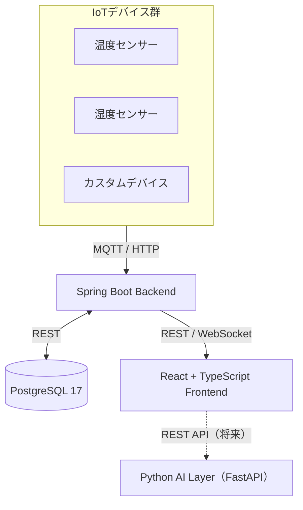

# SmartHomeWebServerBackend

スマートホーム向けWebサーバーバックエンドのシステムドキュメントです。

## プロジェクト情報

| 項目 | 内容 |
| --- | --- |
| プロジェクト名 | SmartHomeWebServerBackend |
| Group ID | `jp.xoki.web.zunda` |
| バージョン | 0.0.1-SNAPSHOT |
| Java | 26 |
| Spring Boot | 3.5.0 |
| ビルドツール | Gradle 9.4.1 |

## 概要

本プロジェクトは自宅スマートホームシステムのバックエンドサーバです。現在はREST API・認証基盤を中心に構築しており、今後IoTデバイスとのデータ連携・AI判断処理の拡張を予定しています。

フリーランス案件の主軸技術として **Spring Boot + React (TypeScript)** を採用し、段階的にIoT・Python AI層を追加していく構成です。

## 主要コンポーネント

- **認証基盤** — Spring Security + JWT (アクセストークン15分 / リフレッシュトークン7日)
- **データアクセス** — jOOQ (OSS版) によるタイプセーフSQL
- **DBマイグレーション** — Flyway (PostgreSQL 17対応)
- **REST API** — Spring Web MVC + SpringDoc OpenAPI (Swagger UI)
- **リアルタイム通信** — WebSocket
- **バッチ処理** — Spring Batch


## システム全体像



## フェーズ構成

| フェーズ | 内容 | 状態 |
| --- | --- | --- |
| Phase 1 | REST API・認証基盤・基本業務機能 (Spring Boot + React) | 🟢 進行中 |
| Phase 2 | IoT / MQTT・監視・通知基盤 | 🔵 計画中 |
| Phase 3 | Python AI・AIエージェント連携 (FastAPI / MCP) | 🔵 計画中 |
| Phase 4 | 履歴データ・ログ・時系列DB導入 (InfluxDB / TimescaleDB) | 🔵 検討中 |
| Phase 5 | Gitサーバ・CI/CD基盤 | 🔵 検討中 |


## クイックスタート

```bash
# 1. PostgreSQL コンテナ起動
docker start zunda-db

# 2. jOOQ クラス生成
./gradlew generateJooq

# 3. アプリケーション起動
./gradlew bootRun -Dspring.profiles.active=local

# 4. Swagger UI で確認
# http://localhost:8080/swagger-ui/index.html
```

!!! note "開発環境の前提"
    - Java 26 (`C:\Program Files\Java\jdk-26`)
    - Docker Desktop
    - IntelliJ IDEA (Community版可)
    - `gradle.properties` に `org.gradle.java.home=C:/Program Files/Java/jdk-26` を設定済みであること


