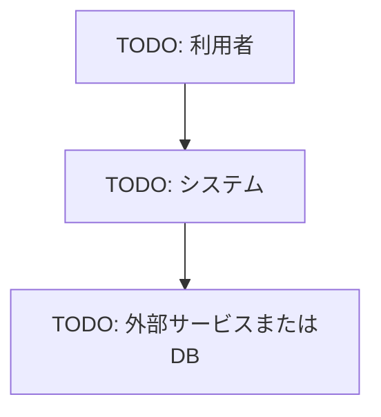

# TODO: プロジェクト名

## プロジェクト情報

| 項目 | 内容 |
| --- | --- |
| プロジェクト名 | TODO |
| 対象システム | TODO |
| 対象フェーズ | TODO |
| 作成日 | YYYY/MM/DD |
| 更新日 | YYYY/MM/DD |

## 概要

TODO: プロジェクトの目的、背景、対象範囲を記載する。

## 主要コンポーネント

| コンポーネント | 役割 |
| --- | --- |
| TODO | TODO |

## システム全体像

## フェーズ構成

| フェーズ | 内容 | 状態 |
| --- | --- | --- |
| TODO | TODO | 未着手 |

## 関連ドキュメント

| ドキュメント | 内容 |
| --- | --- |
| TODO | TODO |

## 備考

- TODO
