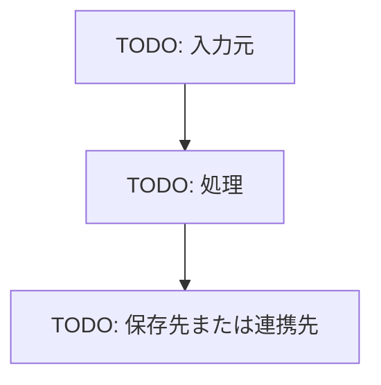

# TODO: 基本設計

## 概要

TODO: 対象機能または対象領域の基本方針を記載する。

## 目的

TODO

## 対象範囲

| 区分 | 内容 |
| --- | --- |
| 対象 | TODO |
| 対象外 | TODO |

## 全体構成

## 構成要素

| 構成要素 | 役割 |
| --- | --- |
| TODO | TODO |

## 主要処理

| 処理 | 内容 |
| --- | --- |
| TODO | TODO |

## 状態遷移

| 状態 | 説明 | 次の状態 |
| --- | --- | --- |
| TODO | TODO | TODO |

## データ方針

| データ | 方針 |
| --- | --- |
| TODO | TODO |

## エラー方針

| 事象 | 対応 |
| --- | --- |
| TODO | TODO |

## 関連ドキュメント

- TODO
