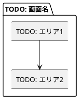
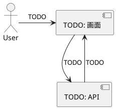

# TODO: 画面名 画面設計書

## 概要

TODO: 画面の目的、利用者、主な操作を記載する。

## 画面構成

## コンポーネント詳細

### 1. TODO: コンポーネント名

| 要素 | 仕様 |
| --- | --- |
| TODO | TODO |

## 入力項目

| 項目 | 型 | 必須 | 制約 | 説明 |
| --- | --- | --- | --- | --- |
| TODO | TODO | TODO | TODO | TODO |

## 状態管理

| State | 型 | 初期値 | 用途 |
| --- | --- | --- | --- |
| TODO | TODO | TODO | TODO |

## 操作フロー

## エラーハンドリング

| 条件 | 表示内容 | 挙動 |
| --- | --- | --- |
| TODO | TODO | TODO |

## アクセシビリティ

| 要素 | 対応 |
| --- | --- |
| TODO | TODO |

## レスポンシブ対応

| ブレークポイント | 表示方針 |
| --- | --- |
| Mobile | TODO |
| Desktop | TODO |

## 実装ファイル

| 種別 | パス |
| --- | --- |
| 画面 | TODO |

## 今後の拡張ポイント

1. TODO
