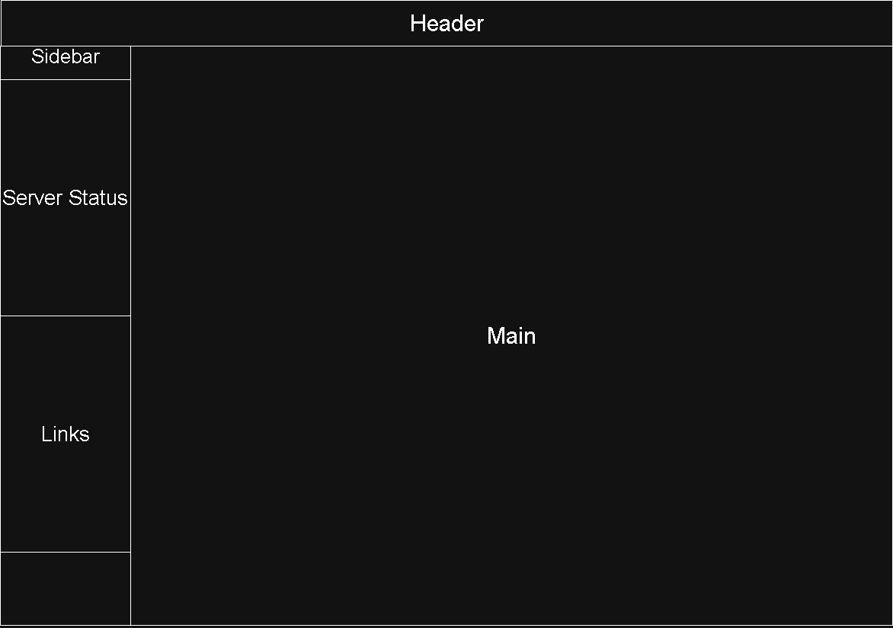

# システム設計

## エージェント登録設計

- [エージェント事前登録・登録コード連携](./認証/0004_agent_registration.md)

## ワイヤーフレーム(ベースデザイン)

## ユーザー管理

| ID | 項目名 | Link |
| --- | :--- | --- |
| FR-0001 | ユーザーの作成・更新・削除 | [Link](./ユーザー管理/FR-0001.md) |
| FR-0002 | ユーザー情報の参照 | [Link](https://www.nicovideo.jp/) |
| FR-0003 | ログイン | [Link](https://www.nicovideo.jp/) |
| FR-0004 | JWTトークン発行 | [Link](https://www.nicovideo.jp/) |
| FR-0005 | セッション管理 | [Link](https://www.nicovideo.jp/) |
| FR-0006 | ロールベースアクセス制御（RBAC） | [Link](https://www.nicovideo.jp/) |
| FR-0007 | サービス単位のアクセス制御 | [Link](https://www.nicovideo.jp/) |
| FR-0008 | 外部向けAPIキー発行 | [Link](./API%20Gateway/0002_external_api_keys.md) |
| FR-0009 | APIキーの無効化 | [Link](./API%20Gateway/0002_external_api_keys.md) |
| FR-0010 | スコープ設定（アクセス範囲制御） | [Link](./API%20Gateway/0002_external_api_keys.md) |

## IoT管理サービス

| ID | 項目名 | Link |
| --- | :--- | --- |
| FR-0011 | IoT機器の登録・削除・更新 | [Link](https://www.nicovideo.jp/) |
| FR-0012 | デバイス一覧取得 | [Link](https://www.nicovideo.jp/) |
| FR-0013 | デバイス状態管理 | [Link](https://www.nicovideo.jp/) |

## MQTT通信

| ID | 項目名 | Link |
| --- | :--- | --- |
| FR-0014 | MQTTブローカーとの接続 | [Link](https://www.nicovideo.jp/) |
| FR-0015 | メッセージ受信・送信 | [Link](https://www.nicovideo.jp/) |
| FR-0016 | トピック管理 | [Link](https://www.nicovideo.jp/) |

## センサーデータ管理

| ID | 項目名 | Link |
| --- | :--- | --- |
| FR-0017 | データ受信・保存 | [Link](https://www.nicovideo.jp/) |
| FR-0018 | デバイス別履歴管理 | [Link](https://www.nicovideo.jp/) |

## タスク管理

| ID | 項目名 | Link |
| --- | :--- | --- |
| FR-0019 | タスク作成・更新・削除 | [Link](https://www.nicovideo.jp/) |
| FR-0020 | タスク状態管理（未着手 / 進行中 / 完了） | [Link](https://www.nicovideo.jp/) |

## スケジュール管理

| ID | 項目名 | Link |
| --- | :--- | --- |
| FR-0021 | 定期実行スケジュール設定 | [Link](https://www.nicovideo.jp/) |
| FR-0022 | Cronベースジョブ管理 | [Link](https://www.nicovideo.jp/) |

## トリガー制御

| ID | 項目名 | Link |
| --- | :--- | --- |
| FR-0023 | イベントトリガーによるタスク起動 | [Link](https://www.nicovideo.jp/) |
| FR-0024 | IoT・AI連携トリガー対応 | [Link](https://www.nicovideo.jp/) |

## 在庫管理

| ID | 項目名 | Link |
| --- | :--- | --- |
| FR-0025 | 在庫登録・更新・削除 | [Link](https://www.nicovideo.jp/) |
| FR-0026 | 在庫数量管理 | [Link](https://www.nicovideo.jp/) |
| FR-0027 | 在庫一覧表示 | [Link](https://www.nicovideo.jp/) |

## 車庫管理

| ID | 項目名 | Link |
| --- | :--- | --- |
| FR-0028 | 車両情報管理 | [Link](https://www.nicovideo.jp/) |
| FR-0029 | 駐車状態管理 | [Link](https://www.nicovideo.jp/) |
| FR-0030 | 車庫状態可視化 | [Link](https://www.nicovideo.jp/) |
| FR-0031 | 在庫検知AI連携 | [Link](https://www.nicovideo.jp/) |
| FR-0032 | 車庫検知AI連携 | [Link](https://www.nicovideo.jp/) |

## サービス監視

| ID | 項目名 | Link |
| --- | :--- | --- |
| FR-0033 | 稼働状況監視 | [Link](https://www.nicovideo.jp/) |
| FR-0034 | ダウン検知 | [Link](https://www.nicovideo.jp/) |

## リソース監視

| ID | 項目名 | Link |
| --- | :--- | --- |
| FR-0035 | CPU / メモリ / ディスク監視 | [Link](https://www.nicovideo.jp/) |

## ヘルスチェック

| ID | 項目名 | Link |
| --- | :--- | --- |
| FR-0036 | ヘルスチェックAPI提供 | [Link](https://www.nicovideo.jp/) |
| FR-0037 | 定期死活監視 | [Link](https://www.nicovideo.jp/) |

## 監視設定UI

| ID | 項目名 | Link |
| --- | :--- | --- |
| FR-0041 | 監視ルール設定 | [Link](https://www.nicovideo.jp/) |
| FR-0042 | 通知条件設定 | [Link](https://www.nicovideo.jp/) |
| FR-0048 | 各種予測処理（在庫・温度・負荷） | [Link](https://www.nicovideo.jp/) |

## 通知機能

| ID | 項目名 | Link |
| --- | :--- | --- |
| FR-0043 | Discord通知送信 | [Link](https://www.nicovideo.jp/) |
| FR-0044 | イベントベース通知 | [Link](https://www.nicovideo.jp/) |
| FR-0045 | 通知チャンネル管理 | [Link](https://www.nicovideo.jp/) |

## 通知ルール

| ID | 項目名 | Link |
| --- | :--- | --- |
| FR-0046 | 重要度別通知制御 | [Link](https://www.nicovideo.jp/) |
| FR-0047 | 条件ベース通知（閾値など） | [Link](https://www.nicovideo.jp/) |

## モデル管理

| ID | 項目名 | Link |
| --- | :--- | --- |
| FR-0050 | 学習モデルのバージョン管理 | [Link](https://www.nicovideo.jp/) |
| FR-0051 | モデル切り替え | [Link](https://www.nicovideo.jp/) |

## AIエージェント連携

| ID | 項目名 | Link |
| --- | :--- | --- |
| FR-0052 | MCP / AI Agentインターフェース提供 | [Link](https://www.nicovideo.jp/) |
| FR-0053 | 外部ツール呼び出し対応 | [Link](https://www.nicovideo.jp/) |

## Gitサーバ

| ID | 項目名 | Link |
| --- | :--- | --- |
| FR-0054 | リポジトリ管理 | [ストレージ・操作整合性](./Git基盤/0001_storage.md) |
| FR-0055 | Git操作受付 | [認証・認可](./Git基盤/0002_authentication_authorization.md) |
| FR-0056 | Git基盤状態・監査・復旧管理 | [バックアップ・復元](./Git基盤/0003_backup_restore.md) |

対象範囲、承認事項、未決定事項は[Git基盤基本設計](./Git基盤/000_index.md)を参照する。

## 気象情報連携

| ID | 項目名 | Link |
| --- | :--- | --- |
| FR-0057 | 気象データ取得 | [Link](https://www.nicovideo.jp/) |
| FR-0058 | 予報情報保存 | [Link](https://www.nicovideo.jp/) |

## 外部情報連携

| ID | 項目名 | Link |
| --- | :--- | --- |
| FR-0059 | Minecraft情報取得 | [Link](https://www.nicovideo.jp/) |
| FR-0060 | Discord bot情報取得 | [Link](https://www.nicovideo.jp/) |

## UI / ダッシュボードサービス

| ID | 項目名 | Link |
| --- | :--- | --- |
| FR-0061 | IoTデバイス一覧表示 | [Link](https://www.nicovideo.jp/) |
| FR-0062 | 在庫管理画面 | [Link](https://www.nicovideo.jp/) |
| FR-0063 | 車庫管理画面 | [Link](https://www.nicovideo.jp/) |
| FR-0064 | 監視ダッシュボード | [Link](https://www.nicovideo.jp/) |
| FR-0065 | 監視設定UI | [Link](https://www.nicovideo.jp/) |

## API Gateway

| ID | 項目名 | Link |
| --- | :--- | --- |
| FR-0066 | リクエストルーティング | [Link](https://www.nicovideo.jp/) |
| FR-0067 | 認証処理 | [Link](https://www.nicovideo.jp/) |
| FR-0068 | レート制限 | [Link](https://www.nicovideo.jp/) |
| FR-0069 | API統合管理 | [Link](https://www.nicovideo.jp/) |
| FR-0049 | API経由で推論実行 | [Link](https://www.nicovideo.jp/) |

### API Gateway 設計

| No | 項目 | Link |
| --- | --- | --- |
| 1 | API Gateway 基本設計 | [Link](./API%20Gateway/0001_gateway_basic_design.md) |

## その他

| ID | 項目名 | Link |
| --- | :--- | --- |
| FR-0038 | アプリケーションログ表示 | [Link](https://www.nicovideo.jp/) |
| FR-0039 | IoTログ表示 | [Link](https://www.nicovideo.jp/) |
| FR-0040 | APIログ表示 | [APIアクセスログ基本設計](../10_LoggingAndMonitoringDesign/0004_api_access_log.md) |

## 実装済み詳細設計

| No | 項目 | Link |
| --- | --- | --- |
| 1 | 認証フロー | [Link](./認証/0001_auth_flow.md) |
| 2 | トークン管理 | [Link](./認証/0002_token_management.md) |
| 3 | ユーザーマスタ参照 | [Link](./ユーザー管理/0003_user_master_reference.md) |
| 4 | デバイスマスタ参照 | [Link](./デバイス管理/0001_device_master_reference.md) |
| 5 | サービスマスタ参照 | [Link](./サービス管理/0001_service_master_reference.md) |
| 6 | 共通エラー制御 | [Link](./共通基盤/0001_error_handling.md) |
| 7 | APIドキュメント公開 | [Link](./共通基盤/0002_openapi.md) |
| 8 | 共通Clock・タイムゾーン | [共通Clock基本設計](./共通基盤/0003_application_clock.md) |
| 9 | FE日時表示・APIエラー | [FE共通表示・エラー基本設計](./共通基盤/0004_frontend_display_and_errors.md) |
| 10 | 共通ページング | [共通ページング基本設計](./共通基盤/0005_pagination.md) |
| 11 | 共通トークンハッシュ | [共通トークンハッシュ基本設計](./共通基盤/0006_token_hash.md) |
| 12 | FE非同期取得 | [FE共通非同期取得基本設計](./共通基盤/0007_frontend_async_request.md) |

## 実装追補

| No | 項目 | Link |
| --- | --- | --- |
| 1 | 認証セッション管理 | [Link](./認証/0003_auth_session_management.md) |
| 2 | バッチ定義マスタ管理 | [Link](./バッチ管理/0001_batch_definition_master.md) |
| 3 | バッチスケジュール管理 | [Link](./バッチ管理/0002_batch_schedule_master.md) |
| 4 | バッチ管理 基本設計 | [Link](./バッチ管理/0006_batch_management_basic_design.md) |
| 5 | バッチ定義管理 詳細設計 | [Link](./バッチ管理/Details/0001_batch_definition_detail_design.md) |
| 6 | バッチスケジュール管理 詳細設計 | [Link](./バッチ管理/Details/0002_batch_schedule_detail_design.md) |
| 7 | バッチ実行要求 詳細設計 | [Link](./バッチ管理/Details/0003_batch_execution_request_detail_design.md) |
| 8 | バッチAgent連携 詳細設計 | [Link](./バッチ管理/Details/0004_batch_agent_integration_detail_design.md) |
| 9 | バッチファイル転送 基本設計 | [Link](./バッチ管理/0007_batch_file_transfer_basic_design.md) |
| 10 | バッチファイル転送 詳細設計 | [Link](./バッチ管理/Details/0005_batch_file_transfer_detail_design.md) |
| 11 | 車検期限管理 基本設計 | [Link](./車両管理/0001_vehicle_inspection_management.md) |

- [Agent専用認証・端末単位認可](./認証/0005_agent_authentication.md)
