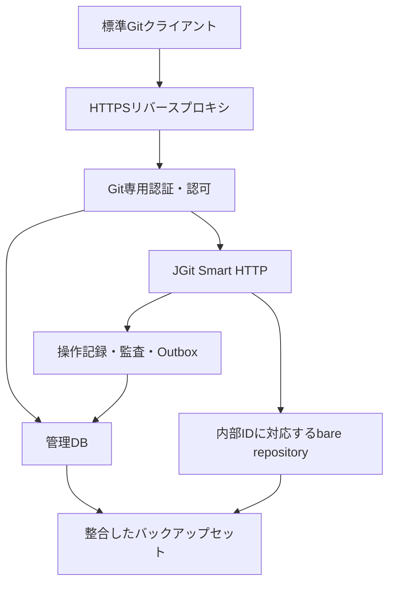

# Git基盤基本設計

## 概要

FR-0054からFR-0056を、単一Backendとローカルbare repositoryによるGit基盤へ具体化する。
2026/10/29時点の基本設計であり、本番機能の実装・導入・結合試験の完了を示すものではない。

GitはMomiServer本体の内蔵機能とする。管理画面は既存FE、管理API・認証認可・JGitによるGit通信受付は既存BEへ組み込む。
別のGitサーバー製品や常設の独立Gitアプリケーションを最終構成の必須サービスにはしない。
GitLabは移行中の既存基盤、GitHubは補助連携先とし、MomiServer本体のGit機能をそれらへのリンクだけで代替しない。
独立Gradleで作成したJGit技術検証は隔離試験のための構成であり、本番機能を別アプリへ分離する決定ではない。

## 目的

Gitの実体、管理DB、利用者の権限、バックアップを別々に管理して復元不能になることを防ぐ。
Git更新とDB更新が同一トランザクションではないことを前提に、失敗時の判断と実装時の受入条件を定める。

## 対象範囲

| 区分 | 内容 |
| --- | --- |
| 対象 | ストレージ、ライフサイクル、HTTPS Git、PAT、認可、ref保護、監査、バックアップ・復元 |
| 別タスク | MomiServer内のGit管理UI、マージ・レビュー、CI/CD、GitHub連携、Git専用Discordの詳細設計・実装 |
| 初期構成 | 単一Backend、単一書込主体、ローカル永続領域、SHA-1形式、HTTPSのみ |
| 初期非対応 | SSH、LFS、partial clone、SHA-256リポジトリ、任意のサーバーhook、複数ノード書込み |

## 全体構成

## 構成要素と設計の正本

| 文書 | 責務 |
| --- | --- |
| [ストレージ・操作整合性](./0001_storage.md) | 内部ID、物理領域、状態、排他、容量、DBとの不整合補完 |
| [認証・認可](./0002_authentication_authorization.md) | PAT、ロール解決、HTTP境界、main保護、失効と監査 |
| [バックアップ・復元](./0003_backup_restore.md) | 整合点、月次フル・週次差分、マニフェスト、検証と公開再開 |

状態・データ・エラー方針は責務ごとの文書に集約し、本書へ重複して定義しない。
ここで挙げるデータモデルは論理モデルであり、実テーブル・APIの作成済み一覧ではない。
別タスクという区分は文書・実施時期の分割であり、Git管理UI等をMomiServerの製品範囲から外す意味ではない。
将来のCIジョブは既存方針どおりAgentの分離実行とし、Git本体への内蔵を理由にBEで任意ジョブを直接実行しない。

## 合意事項と設計判断

| 区分 | 内容 |
| --- | --- |
| ユーザー合意 | システムADMINは全repo管理可。それ以外はグループ・repoのread/write/adminを明示付与し、未付与は拒否 |
| ユーザー合意 | mainへの通常の直接pushは禁止。初回作成・障害復旧だけ管理者の明示操作で例外許可 |
| ユーザー合意 | バックアップ復元後はGit PATをすべて失効し、再発行する |
| ユーザー合意 | Git PATは期限必須。初期値・最大期間は発行から1年、無期限は対象外 |
| ユーザー合意 | 週次差分の比較元は直近月次フル。DBは週次も完全なアーカイブを取得 |
| ユーザー合意 | 通常履歴はrepo物理削除まで保持。到達不能履歴の永久保存は不要。論理容量と実使用量は別管理 |
| ユーザー合意 | 制限設計はGitLab Self-Managedを基準とし、先行する履歴保持・容量指標の合意を維持 |
| ユーザー合意 | 週次は月曜03:00、月次は1日03:00、日本時間。重複日は週次を中止し月次フルのみ実行 |
| ユーザー合意 | Git制限値は共通設定で変更可能。repo保守は当面、最終作業からの利用状況判定のみ |
| ユーザー合意 | 作業判定は初期90日、成功push・repo設定変更が対象。clone・fetchは含めない |
| ユーザー合意 | 論理削除猶予30日、到達不能履歴の復旧猶予・reflog保持90日。自動清掃は当面行わない |
| ユーザー合意 | バックアップは月次フル3世代・週次差分8世代、更新直前分は更新確認後7日保持 |
| ユーザー合意 | 初期制限値・/opt側の正式配置・既存CA流用を承認。値と配置の正本は各領域設計とする |
| ユーザー合意 | BE停止目標30分、一時失敗は60分後に最大2回再試行。復帰時補完は1回、月次未成功ならフル優先 |
| ユーザー合意 | VPNなし外部公開はWebと必要なAPI・WSのみ。Git通信はLAN／VPN内。検索非掲載とデータ保護を別途適用 |
| 設計判断 | グループ階層の権限は加算型継承。上位で得た権限を子repoの低い権限で取り消さない |
| 設計判断 | 書込み前に操作予定をDBへ確定し、ref確定後のDB障害は次の書込みを止めて照合する |
| 設計判断 | 初期バックアップはdrain後にBEを停止して整合点を作る。無停止取得を前提にしない |

一般Web画面は既存のロール単位制御を維持する。Gitの個別アクセス許可はGit領域だけの例外であり、
既存画面・在庫API・Agent認証・外部APIキーへ権限モデルを横展開しない。

## 技術検証との対応

[JGit技術検証](../../08_TestDesign/0017_jgit_smart_http_spike.md)で、JGit 7.8.0.202609011348-rと
Boot 3.5.0・Tomcat 10.1.61の隔離構成をWindows・Linux各17件で確認した。
本番実装時は、その時点のBE依存関係とCentOS環境で再確認する。

| 検証済みの根拠 | この設計で追加する未検証事項 |
| --- | --- |
| HTTPS、標準Git、認証・権限fixture | 既存SecurityConfig、実DBのPAT・権限、プロキシとの統合 |
| main保護、atomic push、競合・中断 | 初回・復旧の例外許可、権限変更との競合、操作予定からの監査補完 |
| 単一objectサイズ制限 | pack全体、実ディスク容量、同時受信予約、プロキシ制限 |
| 静止したrepoの別領域復元 | DBを含む月次・週次取得、差分復元、全PAT失効、CentOS実機 |

## 設計の決定状況

| ID | 項目 | 状態・次の作業 |
| --- | --- | --- |
| GD-01 | PAT期限の初期値・最大期間 | 決定済み。発行から1年、無期限なし。短い期限の選択は可能 |
| GD-02 | 容量・通信制限 | 初期値決定済み。pack512 MiB・object50 MiB・push全体2件、空き100/50 GiB、無通信5分 |
| GD-03 | 削除猶予・prune猶予 | 決定済み。論理削除30日、復旧猶予・reflog90日。保守は状態判定のみ、自動清掃は将来対応 |
| GD-04 | 週次差分の比較元 | 決定済み。直近月次フル基準、DBは週次も完全取得 |
| GD-05 | 運用値・設備 | 基本方針決定済み。正式配置・停止再実行・Web限定公開・GitのLAN/VPN限定を合意 |

## 設計タスクの完了範囲

2026/10/29に、Git基本設計の導入条件・初期値を確定するタスクは完了とした。
具体DNS名・証明書検証更新・公開経路・検索制御の運用設定は、本タスクの完了条件に含めない。
予約容量の実測、外部退避、実機受入も設計タスクを継続する理由にせず、既存の導入・運用側で扱う。
追加の同種タスクは作らず、[本番導入・運用受入](../../07_OperationsDesign/0005_production_acceptance.md)とタスク一覧へ集約する。

この整理は合意済みの公開制限・認証認可・検索非掲載・バックアップ保護を撤回するものではない。
設計タスクの完了と本番設定・構築・受入の完了を区別し、必要な設定が未成立のまま公開・稼働を許可しない。
Git基盤Phase 0全体の完了判定は、別タスクのUI・CI/CD要件およびGit専用通知設計も含めて行う。

## 関連ドキュメント

- [FR-0054 リポジトリ管理](../../01_RequirementsDefinition/FR/0054.md)
- [FR-0055 Git操作受付](../../01_RequirementsDefinition/FR/0055.md)
- [FR-0056 状態・監査・復旧管理](../../01_RequirementsDefinition/FR/0056.md)
- [Git基盤の判断記録](../../90_MeetingMinutesAndNotes/git_platform_and_notification_decisions_20261017.md)
- [本番導入・運用受入](../../07_OperationsDesign/0005_production_acceptance.md)
