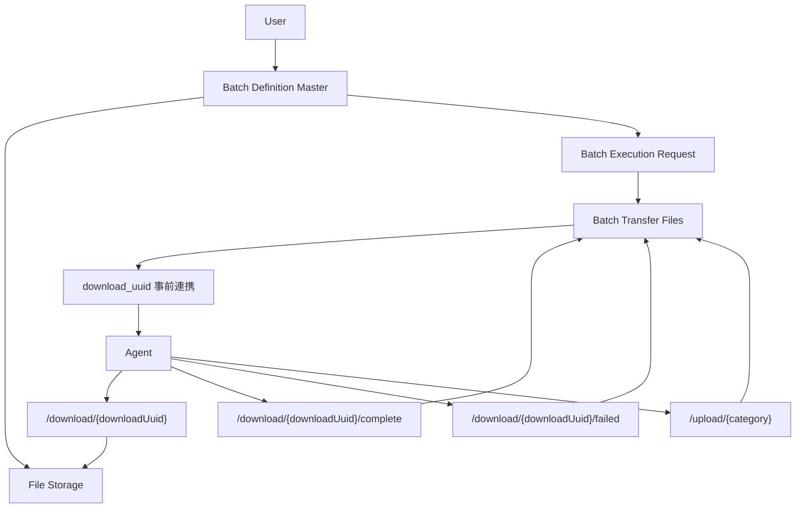

# バッチファイル転送 基本設計

## 概要

バッチ実行に関連するログ、成果物、入力ファイル、実行スクリプトを Agent と Momi Server 間で転送する。
アップロードはカテゴリ別エンドポイントで受け付け、ダウンロードは事前連携された使い切り UUID で実施する。

ユーザーが登録する実行スクリプトや入力ファイルは、バッチ定義マスタに紐づく親データとして管理する。
バッチ実行要求を作成した後、親データから実行要求単位の転送データを作成し、Agent へダウンロード UUID を連携する。

## 目的

バッチ処理の実行結果を追跡しやすくし、Agent が必要なファイルを安全に取得できるようにする。

## 対象範囲

| 区分 | 内容 |
| --- | --- |
| 対象 | Agent からのログアップロード、成果物アップロード、Agent によるファイルダウンロード |
| 対象外 | 汎用ファイルストレージ、大容量ファイル分割アップロード、ユーザー向け直接ファイル共有 |

## 全体構成

## 構成要素

| 構成要素 | 役割 |
| --- | --- |
| Agent | バッチ実行、ログ送信、成果物送信、必要ファイル取得を行う |
| Momi Server | ファイル受信、ファイル配布、メタ情報管理、UUID再生成を行う |
| Batch Definition Master | ユーザーが登録したバッチ定義と、実行に必要なスクリプト、入力ファイル、設定ファイルを管理する |
| Batch Transfer Files | バッチ実行要求単位のアップロード、ダウンロード、UUID、転送状態を管理する |
| File Storage | ファイル本体を保存する |
| File Metadata DB | ファイル種別、状態、UUID、ハッシュ値、保存先を管理する |

## 主要処理

| 処理 | 内容 |
| --- | --- |
| 配布ファイル登録 | ユーザーが実行に必要なファイルをバッチ定義マスタへ登録する |
| 実行要求単位の転送データ作成 | バッチ実行要求作成後、配布対象ファイルを転送データへ展開する |
| ログアップロード | Agent が `/upload/log` へ実行ログを送信する |
| 成果物アップロード | Agent が `/upload/artifact` へ成果物を送信する |
| ダウンロードメタ情報連携 | Server が Agent へ UUID、ファイル名、形式、ハッシュ値を連携する |
| ファイルダウンロード | Agent が `/download/{downloadUuid}` でファイルを取得する |
| ダウンロード完了通知 | Agent が受信と検証成功後に完了通知を送信する |
| ダウンロード失敗通知 | Agent が取得失敗または検証失敗時に失敗通知を送信する |

## 状態遷移

### アップロード

| 状態 | 説明 | 次の状態 |
| --- | --- | --- |
| uploading | アップロード受付中 | completed、failed |
| completed | アップロード完了 | deleted |
| failed | アップロード失敗 | uploading |
| deleted | 削除扱い | なし |

### ダウンロード

| 状態 | 説明 | 次の状態 |
| --- | --- | --- |
| ready | ダウンロード可能 | downloading、expired、deleted |
| downloading | Agent が取得中 | consumed、failed |
| consumed | Agent が取得と検証を完了 | ready |
| failed | Agent が取得または検証に失敗 | ready、expired |
| expired | 有効期限切れ | ready、deleted |
| deleted | 削除扱い | なし |

## データ方針

| データ | 方針 |
| --- | --- |
| ファイル本体 | DB には保存せず、サーバー側ストレージへ保存する |
| バッチ定義配布ファイル | バッチ定義マスタに紐づく親データとして管理する |
| バッチ転送ファイル | バッチ実行要求作成後に実行要求単位で管理する |
| download_uuid | バッチ転送ファイルに対する使い切りの取得用トークンとして管理する |
| ファイル形式 | URL には含めず、事前連携メタ情報として管理する |
| ハッシュ値 | SHA-256 を基本とし、アップロード後またはダウンロード後の検証に利用する |

保存ルートは設定ファイルで任意のディレクトリを指定し、実体の保存名はバックエンドが生成するUUID v4とする。
元のファイル名はメタ情報として分離する。設定項目・相対パス管理・保存先変更時の手順は
[ファイル転送詳細設計](./Details/0005_batch_file_transfer_detail_design.md)を参照する。

## エラー方針

| 事象 | 対応 |
| --- | --- |
| 未対応カテゴリ | 入力エラーとして扱う |
| Agent と実行要求が紐づかない | 権限エラーとして扱う |
| UUID が無効 | リソース未検出または期限切れとして扱う |
| ダウンロード後の検証失敗 | Agent が失敗通知を送信し、Server は再発行可能な状態にする |
| 完了通知未到達 | 一定時間後に失敗または期限切れへ更新する |

## 関連ドキュメント

- [バッチ実行ファイルアップロード](../../01_RequirementsDefinition/FR/0073.md)
- [バッチ実行ファイルダウンロード](../../01_RequirementsDefinition/FR/0074.md)
- [バッチ定義配布ファイル管理](../../01_RequirementsDefinition/FR/0075.md)
- [バッチファイル転送 詳細設計](./Details/0005_batch_file_transfer_detail_design.md)
- [m_batch_files](../../04_DatabaseDesign/Tables/m_batch_files.md)
- [t_batch_transfer_files](../../04_DatabaseDesign/Tables/t_batch_transfer_files.md)

## 追加合意: 定義添付から実行までの責務

添付はバッチ定義で管理し、実行要求作成時に対象ファイルと配置先を固定する。定義の差し替えは作成済み要求へ反映しない。
バックエンドはファイル保存・参照管理・添付上限検証を行い、Agentは実行専用領域への取得・検証・実行・期限後の回収を行う。
固定ディレクトリが必要な処理はスクリプト側が実行アカウントの権限内で行う。
共通設定の保存値を設定ファイルの初期値より優先する。実行ごとの保持期間は要求作成時に固定し、結果再送の保存領域は作業領域から分離する。
決定値と例外時の扱いは[詳細設計の合意仕様](Details/0005_batch_file_transfer_detail_design.md)を参照する。2026年9月23日に実装へ反映した。上記の転送UUID・成果物アップロード等の拡張案とは区別し、現在のAPIと保存契約は詳細設計の実装事項を参照する。
