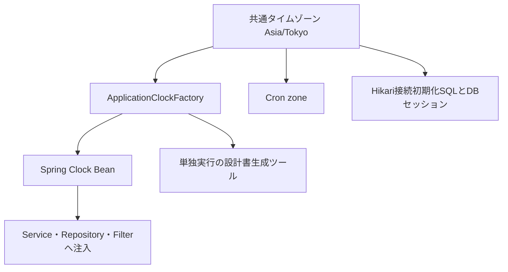

# 共通Clock・タイムゾーン基本設計

## 概要

日時型は維持し、現在日時の取得元と業務タイムゾーンを共通化する。
個人設定の更新日時に対するSonarQubeのjava:S8688を契機に、同じ取得方法を使う既存機能も揃える。

## 目的

- 実行ホストのタイムゾーンに依存する日付・期限のずれを防止する。
- テストで時計を固定し、期限や日本時間の日付境界を再現可能にする。
- 現在日時の値をキャッシュせず、Clockの生成元だけを一元管理する。

## 対象範囲

| 区分 | 内容 |
| --- | --- |
| 対象 | 認証、個人設定、Agent、バッチ、通知、在庫、車両、監視、APIアクセスログ、外部APIキー |
| 対象外 | フロントエンド変更、既存データの補正、日時型・API構造・DBスキーマの変更 |

## 全体構成

## 構成要素

| 構成要素 | 役割 |
| --- | --- |
| ApplicationTimeConstants | Java側の業務タイムゾーンとCron用zone名の唯一の定義 |
| ApplicationClockFactory | 日本時間のシステム時計の生成元。日時の値は保持しない |
| ApplicationTimeConfiguration | アプリケーション全体に注入するClock Beanを登録 |
| 各利用クラス | Clockをコンストラクタで受け取り、必要な日時型のnowへ渡す |
| application.yaml | Hikariの新規接続へSET TIME ZONEを実行し、DBセッションを日本時間へ揃える |

## 主要処理

| 処理 | 内容 |
| --- | --- |
| ローカル日時・業務日付 | LocalDateTime・LocalDate等は注入されたClockで取得する |
| 絶対時刻 | JWTや期限のInstantは絶対時刻のまま保持。JWTライブラリの検証にも同じClockを渡す |
| オフセット付き日時 | OffsetDateTimeは同じClockから取得。DBのtimestamptzの絶対時刻は維持 |
| 型変換 | セッション期限やファイル更新日時のInstantからの変換はClockのzoneを使用する |
| 定期処理 | 日次バッチ、車検通知、取込原本削除、APIログ削除のCronに共通zoneを指定 |
| 相対時間 | fixedDelay・fixedRateの周期、System.nanoTimeによる経過時間計測は維持する |
| レート制限 | epochベースのミリ秒・秒はClockで取得し、ウィンドウの単位・意味は維持する |

## データ方針

| データ | 方針 |
| --- | --- |
| タイムゾーンなしDB日時 | 日本時間として保存・比較する。SQLのlocaltimestamp等も同じDBセッションで評価 |
| 既存履歴 | 値を変換・再保存しない。利用中DBはAsia/Tokyoであることを読み取りで確認済み |
| 他環境の履歴 | UTC等で保存したタイムゾーンなし日時がある環境では、導入前に意味と変換方針を確認する |
| 生成コード | jOOQ生成物は手編集しない。共通化のためのマイグレーションは追加しない |

## エラー・保守方針

- Spring管理クラス内でClockを独自生成せず、依存として必須にする。
- 引数なしnow、ZoneId.systemDefault、業務コード内のSystem.currentTimeMillisは再追加しない。
- 単独実行ツールとテストはFactoryを直接利用できる。境界試験ではClock.fixed等を優先する。
- 取得方法とCronのzone指定はApplicationTimePolicyTestで回帰確認する。
- 日本時間の文字列は設定ファイルにも必要なため、ClockとDBセッションの一致を実DBの統合テストで検証する。
- 適用時はバックエンドを再起動し、Hikari接続の初期化設定を反映する。

## 関連ドキュメント

- [共通Clockテスト](../../08_TestDesign/0014_application_clock_test.md)
- [今回の更新記録](../../90_MeetingMinutesAndNotes/weekly_document_progress_20261024.md)
