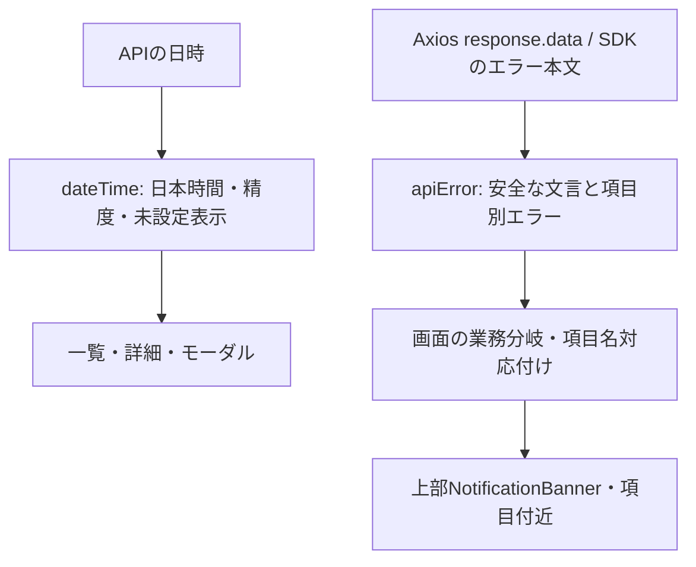

# FE共通日時表示・APIエラー処理 基本設計

## 概要

画面に分散していたAPI日時の整形とエラー本文の抽出を共通部品へ集約する。
業務上の日付計算・認証フロー・API契約は変更せず、表示処理と応答形式の差だけを吸収する。

## 目的

- BEの日本時間方針と、端末のタイムゾーンが異なる場合も同じ日時を表示する。
- 通知、APIログ、APIキー、Agent、添付ファイル等で表示の揺れを抑える。
- Axiosと生成SDKのエラー形式を吸収し、画面固有の文言と入力検証を維持する。

## 対象範囲

| 区分 | 内容 |
| --- | --- |
| 対象 | API日時の表示、APIエラーメッセージ・HTTPステータス・項目別エラーの抽出 |
| 対象外 | BE変更、日付入力・送信形式、Cron・カレンダーの計算、非同期取得の共通化、ページング・認証方式の変更 |

## 全体構成

## 構成要素

| 構成要素 | 役割 |
| --- | --- |
| src/lib/dateTime.ts | 共通日時表示。既存utilsからの再公開も維持 |
| src/lib/dateTime.constants.ts | 日本時間のzone・offsetと対応日時形式 |
| src/lib/apiError.ts | 応答本文の差を吸収し、メッセージ・HTTPステータス・項目別エラーを取得 |
| src/lib/apiError.constants.ts | 項目別エラーの既存形式とHTML判定の定義 |
| 各画面 | 代替文言、表示精度、未設定ラベル、業務分岐、フォームの項目名対応付けを所有 |

## 主要処理

| 処理 | 内容 |
| --- | --- |
| オフセット付き日時 | Z・+09:00等の絶対時刻をAsia/Tokyoへ変換 |
| オフセットなし日時 | LocalDateTimeをBEと同じ日本時間として解釈。PostgreSQLの空白区切りも許容 |
| 表示精度 | 既定はミリ秒付き。ログ、APIキー、Agent、添付等では秒までの表示を指定 |
| 日付のみ | 有効なYYYY-MM-DDは日付を動かさず保持。不正な日付は代替表示 |
| エラー本文 | Axiosのresponse.dataと生成SDKの直接の本文に対応。message、error、従来の文字列本文を扱う |
| 項目別エラー | errors・fieldErrors・validationErrors・details・violationsの配列・辞書を吸収。最初の有効文言を採用 |
| フォーム対応 | ユーザー管理のメール・パスワード・ロールの項目名対応付けは画面側に維持 |
| 状態別処理 | パスワード変更の400、車検更新の409等の既存分岐を維持 |

## データ方針

| データ | 方針 |
| --- | --- |
| 日時の送受信 | APIの形式を変更しない。共通関数は表示だけに使用 |
| 車検日付・カレンダー | 既存の日付計算を維持。日付に表示用のタイムゾーン変換をかけない |
| 日時入力欄 | datetime-localの入力・送信変換は既存仕様を維持 |
| 未設定ラベル | 既定はハイフン。APIキー等の画面別ラベルは指定により維持 |
| 秒・時刻 | 共通表示は0埋めする。APIキー確認モーダルの既存試験も09時表記へ更新 |

## エラー方針

- 不正日時はRangeErrorを発生させず、画面指定の未設定表示へ戻す。
- 空白だけの文言、型が異なる値、HTML応答は画面固有の代替文言へ戻す。
- 通信ライブラリのError.message、stack、request、config、入力のrejectedValueは表示しない。
- クライアントの入力検証文言は画面が明示的に指定し、生のError.messageを代替文言に使用しない。
- 通知のページ上部・モーダル内外の位置、入力保持、通知を閉じる動作は変更しない。
- 項目名を安全に扱うため、抽出結果はMapから辞書へ生成し、特殊な名前によるprototype変更を防ぐ。

## 関連ドキュメント

- [BE共通Clock](./0003_application_clock.md)
- [FE共通日時表示・APIエラーテスト](../../08_TestDesign/0015_frontend_display_error_test.md)
- [更新記録](../../90_MeetingMinutesAndNotes/weekly_document_progress_20261024.md)
