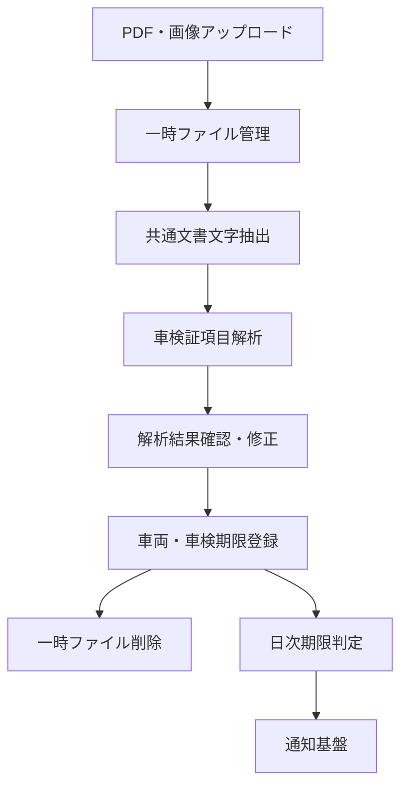

# 車検期限管理 基本設計

## 概要

車検切れ防止を目的として、車両情報と車検有効期間満了日を管理する。
初期実装では手動登録・閲覧・編集・管理終了・期限履歴、確認付きの車検証ファイル取込と期限通知を提供する。
車両所有者台帳を目的とせず、所有者・使用者の氏名および住所は保持しない。

## 目的

- 車検期限の見落としを防ぐ。
- 車検証PDFまたは撮影画像から登録作業を補助する。
- 誤認識した情報が自動登録されることを防ぐ。
- 個人情報を必要以上に保存しない。

## 対象範囲

| 区分 | 内容 |
| --- | --- |
| 初期実装済み | 車両一覧・詳細、手動登録・編集、管理終了、車検期限履歴、期限状態判定、ロール認可、PDF・画像解析、解析結果確認、日次期限通知 |
| Phase 1追加実装済み | 満了日当日の独立通知、登録・期限更新後の判定 |
| 通知追加の対象外 | 期限更新による旧通知の自動解消、車両別通知ON/OFF |
| 対象外 | 所有者・使用者台帳、住所管理、名義変更手続、車検予約、整備記録、原本の永続保管 |

## 全体構成

以下は現行構成である。車両管理画面、車両管理Service、車両情報および期限履歴、PDF・画像取込、共通OCR、確認画面を実装済みとする。

## 構成要素

| 構成要素 | 役割 |
| --- | --- |
| 車両管理画面 | 車両一覧・詳細・期限状態・履歴を表示する |
| ファイル取込画面 | PDF・画像を選択し、解析を開始する |
| 解析結果確認画面 | 原本と解析結果を比較し、修正後に登録する |
| 車両管理Service | 車両登録、更新、重複判定、履歴記録を行う |
| 共通文書文字抽出Service | PDFテキスト抽出とOCRを業務非依存の統一インターフェースで扱う |
| OCRエンジン | 画像化された文書から文字列を取得し、失敗時は共通エラーを返す |
| 車検証項目解析Service | 共通の文字抽出結果を車検証項目へ対応付け、業務検証を行う |
| 一時ファイル管理 | 確認中の原本を保管し、各削除契機で物理削除する |
| 車検期限判定Scheduler | 日次で期限状態と通知対象を判定する |
| 通知基盤 | `vehicle_inspection_expiry`通知を利用者へ配信する |

## 文書文字抽出の共通化方針

### 責務境界

文書文字抽出は車両管理に閉じた機能にせず、他機能からも利用できるバックエンド共通部品として実装する。
共通部品は文字の取得と抽出品質の報告までを担当し、抽出された文字の業務上の意味は判断しない。

| 区分 | 責務 |
| --- | --- |
| 共通文書文字抽出 | MIMEタイプとファイル内容の検証、PDFテキスト抽出、スキャンPDFの画像化、OCR実行、ページ別結果の統合、タイムアウト制御 |
| 共通の抽出結果 | 抽出文字列、抽出方式および警告を返却する |
| 車検証項目解析 | 登録番号、車台番号、車名、型式、初度登録年月、満了日等への対応付けと形式検証を行う |
| 車両管理 | 確認画面、重複判定、登録、履歴、権限、監査、期限通知を管理する |

共通部品は氏名や車台番号等の意味を判定しない。車検証固有の抽出規則と必須項目判定を車両管理側に置くことで、在庫ラベル、機器銘板、保証書等の文書にも再利用できる構造とする。

### 実装済み取込機能の方式

- アップロード、認可、一時ファイル管理、抽出処理の制御、項目解析、DB登録および監査はJava・Spring Bootで実装する。
- テキストPDFはApache PDFBoxを使用して埋め込みテキストを抽出する方針とする。
- 画像およびスキャンPDFは、JavaからローカルのTesseract CLIを呼び出してOCRする方針とする。
- Java側にOCRエンジンのインターフェースを設け、車両管理ServiceがTesseractへ直接依存しない構造とする。
- 実資料による評価で精度が不足した場合は、画像前処理、文字領域の切出し、Tesseractの設定および学習データを先に改善する。
- Tesseractはサーバーへ別途導入し、実行ファイルと`jpn+eng`言語データを設定する外部前提とする。未導入・失敗時は安全に失敗し、手動登録へ誘導する。
- Tesseract以外のOCRエンジンは自動的に追加せず、供給元とセキュリティを個別確認したうえで採用を判断する。
- 車検証原本を外部クラウドOCRへ送信する方式は標準構成に含めない。

### 車検証閲覧アプリの記録事項PDF

- PDFの埋め込み文字は座標順に取得し、内部の描画命令の保存順に依存しない。
- 全角英数字は正規化し、車台番号内の空白と車名末尾の括弧付きコードを除外する。
- 「自動車登録番号又は車両番号」「登録年月日／交付年月日」を項目名として認識する。
- 横並びの交付年月日・初度登録年月・有効期間満了日は、3列の見出しと3つの値が対応する場合だけ採用する。
- 令和・平成・昭和および元年を西暦へ変換し、不正な日付や元号の期間外の値は採用しない。
- 型式と原動機の型式を区別し、氏名・住所などの個人情報は候補値へ含めない。
- 提供サンプルで主要7項目の原本との一致を確認済み。他の版式・画像の認識精度は別途確認する。

### ソフトウェアサプライチェーン方針

- 中国企業または中国系組織が主要な開発・保守・配布主体となるライブラリ、OCRモデルおよび外部サービスは原則採用しない。
- PaddleOCRおよびPaddlePaddleは採用候補から除外する。
- 新規ライブラリの採用時は、開発・保守主体、ライセンス、配布元、更新履歴、既知の脆弱性および推移的依存関係を確認する。
- 実行ファイル、モデルおよび言語データは取得元を固定し、バージョンとチェックサムを構成管理する。
- 例外採用が必要な場合は、採用理由、代替不能性、確認結果および承認者を判断記録へ残す。

想定する実装単位は以下とする。実際のクラス名とパッケージは詳細設計時に既存構成へ合わせて確定する。

| 実装単位 | 役割 |
| --- | --- |
| `DocumentTextExtractionService` | ファイル形式に応じてテキスト抽出またはOCRを選択する |
| `OcrEngine` | OCRエンジン差し替え用の共通インターフェース |
| `TesseractOcrEngine` | Tesseract CLIの実行、タイムアウト、終了コード判定を行う |
| `DocumentExtractionResult` | 抽出文字列、抽出方式および警告を保持する |
| 車検証項目解析Service | 共通結果から車検証項目候補を作成する |

### 取込機能のファイルと結果の保持責任

- 一時ファイルのライフサイクルは、アップロードから確認登録までを管理する車両管理の取込処理が所有する。
- 共通文書文字抽出Serviceは受け取った原本の永続化や削除期限を管理しない。
- 取込処理は正常終了、解析失敗、キャンセルおよび確認期限超過の各経路で原本を削除する。
- 共通の抽出結果に所有者・使用者の氏名や住所が含まれ得るため、抽出全文をDBまたはアプリケーションログへ保存しない。
- 車両管理側は保存対象として定義された項目候補だけを確認画面へ返却する。

## 主要処理

| 処理 | 内容 |
| --- | --- |
| 手動登録 | 必須項目を入力して車両を登録する |
| ファイル解析 | PDFテキスト抽出を優先し、必要時にOCRを実行する |
| 確認登録 | 読み取り結果を利用者が確認・修正してから登録する |
| 重複判定 | 車両識別符号、車台番号、登録番号等で既存車両を確認する |
| 期限更新 | 新しい満了日を保存し、更新前後の値を履歴へ記録する |
| 期限通知 | 満了日までの日数に応じて通知を作成する |
| 管理終了 | ADMINが車両を管理対象外へ変更する |

### 車検更新専用操作

車両詳細の車検更新モーダルから、車検情報だけを専用APIで更新する。
満了日の候補計算は画面側の入力補助であり、車検証に合わせた手動修正を許可する。
現在日ではなく登録済み満了日を基準とし、一般の車両編集フォームの未保存値を送信しない。

Serviceは車両を行ロックし、クライアントの更新前満了日とDBを照合する。
更新後満了日、交付年月日、期限状態、更新者・日時だけを更新し、`EXPIRY_UPDATED`履歴を同一トランザクションで保存する。
API入力とエラーは[車両管理API](../../05_API_Design/API/0047_vehicle_management.md)を参照する。
車検更新操作自体のDBスキーマは変更しない。通知段階のCHECK制約はV39で`DUE_TODAY`を許容する。
2026/10/26の方針見直しにより、旧通知の自動解消は追加しない。

## 状態管理

### 取込状態（実装済み）

アップロード受付と解析は同一API内で同期実行し、受付中・解析中の状態はDBへ保存しない。

| 状態 | 説明 | 次の状態 |
| --- | --- | --- |
| `PENDING_REVIEW` | 利用者の確認・修正待ち | `REGISTERED`、`CANCELLED`、`EXPIRED` |
| `PARSE_FAILED` | 解析失敗 | 終了。原本削除後に手動登録可能 |
| `REGISTERED` | 車両登録完了 | 終了。原本削除 |
| `CANCELLED` | 利用者が取込を中止 | 終了。原本削除 |
| `EXPIRED` | 確認期限超過 | 終了。原本削除 |

### 車検状態

| 状態 | 判定案 | 表示 |
| --- | --- | --- |
| `VALID` | 満了日まで31日以上 | 有効 |
| `DUE_SOON` | 満了日まで30日以内 | 期限接近 |
| `URGENT` | 満了日まで7日以内 | 要対応 |
| `EXPIRED` | 満了日を経過 | 車検切れ |
| `UNKNOWN` | 満了日を判定できない | 未確認 |
| `ARCHIVED` | 管理対象外 | 管理終了 |

初期実装では上記の境界日数を採用し、管理終了は`ARCHIVED`による論理削除とする。

## データ方針

### 車検期限通知

現行実装は毎日09:00（Asia/Tokyo）とアプリケーション起動時に管理中の車両を確認する。
バックエンド内部の定期処理であり、Agent向けバッチスケジュールへの登録は不要。

#### 通知段階の確定仕様

2026/10/24に当日通知の追加を確定し、2026/10/26に追加対象を当日通知と保存成功後の判定へ限定した。
以下の5段階と保存後判定を2026/10/26に実装した。
`SEVEN_DAYS`から当日を分離し、既存記録があっても当日は独立して1回通知する。

| 段階 | 判定開始・期間 | 重要度 | 実装差分 |
| --- | --- | --- | --- |
| `TWO_MONTHS` | 満了日の2か月前（暦月）から | warning | 既存を維持 |
| `ONE_MONTH` | 満了日の1か月前（暦月）から | warning | 既存を維持 |
| `SEVEN_DAYS` | 満了日の7日前から前日 | critical | 当日を除く |
| `DUE_TODAY` | 満了日と判定日が同日 | critical | V39で追加 |
| `EXPIRED` | 満了日の翌日以降 | critical | 原則1回の既存方針を維持 |

- 月末の減算は対象月の末日に丸める。60日・30日の固定日数とは区別する。
- 停止後の起動や通知期間内の新規登録は、次の確認時点に該当する最新段階を1回通知する。過去段階をまとめて通知しない。
- [通知済み記録](../../04_DatabaseDesign/Tables/t_vehicle_inspection_notifications.md)は車両・満了日・段階で一意とする。
- 車両を行ロックし、管理状態と満了日を再確認する。通知作成と通知済み記録は同一トランザクションで確定し、失敗時は次回再試行する。
- 管理終了車両は対象外。満了日を更新した場合は新しい満了日で段階ごとに通知する。
- 通知種別は`vehicle_inspection_expiry`、発生元は`vehicle`、発生元IDは車両ID、関連画面は`/vehicles/{id}`。
- 初期ルートは`ROLE_ALL`へのブラウザ通知。全体通知ロールの割当があるユーザーが受信する。その他の宛先やDiscordは通知ルート設定で指定する。
- 通知全体設定とユーザー別受信設定に従う。全体設定が無効、または両チャネルが無効なら通知段階を消費しない。
- `/alerts`、トップ画面、サイドバー件数は既存のユーザー別通知APIで反映する。
- 通知時期と一覧の期限状態（30日・7日）は別の判定である。

#### 保存成功後の期限判定（実装済み）

- 登録・満了日更新の保存成功後にも、最新の満了日と通知段階を判定する。
- 既に通知期間内の場合は、現在該当する未通知段階を1回通知する。過去段階を一括送信しない。
- 日次・起動時・保存後の判定は同じ車両・満了日・段階の重複防止を使用する。
- 保存後判定でも、通知全体設定、通知ルート、ユーザー別受信設定を適用する。車両別ON/OFFは設けない。
- 車両登録・満了日変更・車検更新でイベントを発行し、外側の保存トランザクションがコミットした後に判定する。
- コミット後の入口だけで新規トランザクションを開始する。日次・起動時のService委譲と車両単位の行ロックを維持する。
- 保存がロールバックした場合は通知しない。通知失敗は記録して次の日次判定で補完し、保存済み車両を失敗扱いへ戻さない。

#### 車検更新後の旧通知（自動解消は追加対象外）

- 2026/10/26の方針見直しにより、期限更新による旧通知の自動解消は行わない。
- 満了日が更新されても、旧通知を自動的に既読化・非表示・削除しない。
- アラート一覧・トップ通知・未読件数は既存の取得条件を維持し、通常の既読・非表示・保持期間の処理に従う。
- 通知解消用の状態・API・履歴画面は追加しない。新しい満了日は既存どおり別の通知周期として扱う。

#### 車両別設定（追加対象外）

| 項目 | 確定仕様 |
| --- | --- |
| 車両別ON/OFF | 追加しない。専用のDB項目・API項目・画面操作を設けない |
| 通知時期 | 上記の共通5段階。車両別の時期設定は追加しない |
| 配信先 | 既存の通知ルート設定を使用。車両専用の配信先設定を新設しない |
| 有効・無効の制御 | 既存の通知全体設定・通知ルート・ユーザー別受信設定を利用する |

配信先がない状態で判定済みとなった通知について、配信先設定後の再通知は行わない。
Discord送信失敗時の再送も行わない。
これらは通知作成トランザクションの失敗と区別し、車両・通知の整合性を維持する。

### 保存対象

| データ | 方針 |
| --- | --- |
| 車両情報 | 車検期限管理に必要な識別情報だけを保存する |
| 氏名・住所 | 抽出・保存・ログ出力の対象外とする |
| 車検証原本 | 確認中だけ一時保存し、登録、取消、解析失敗、期限超過時に削除する |
| OCR中間画像 | 原本と同じ所有者限定領域へ保存し、ページ処理後に削除する。残存時は孤立ファイル回収対象とする |
| ファイルハッシュ | 保存しない。ランダムな一時保存参照だけを保存する |
| 解析情報 | 解析方式、状態、取込日時、警告を保存する |
| 車検期限履歴 | 更新前後の期限、更新者、更新日時を保存する |
| 状態値 | DBとAPIでは英語値を使用する |

## 権限方針

| 操作 | ADMIN | OPERATOR | USER |
| --- | --- | --- | --- |
| 閲覧 | 可 | 可 | 可 |
| 登録・編集・ファイル取込 | 可 | 可 | 不可 |
| 管理終了・削除 | 可 | 不可 | 不可 |

フロントエンドのボタン制御だけで完結させず、バックエンドでもロール単位に認可する。

## エラー方針

| 事象 | 対応 |
| --- | --- |
| 未対応ファイル | 解析を開始せず、対応形式を案内する |
| 必須項目未取得 | 確認画面で対象項目を警告表示する |
| 重複候補 | 既存車両との差分確認へ遷移する |
| 一時ファイル削除失敗 | 原本名をログへ出さず、ランダム参照IDだけを記録して定期再削除する |
| 通知作成失敗 | 既存通知基盤の再試行・監視方針に従う |

## 未確定事項

- Tesseractによる日本語帳票の精度受入基準と、精度不足時の前処理・設定改善基準

## 関連ドキュメント

- [車検期限管理 要件定義](../../01_RequirementsDefinition/FR/0076.md)
- [車両管理画面設計](../../06_UserInterfaceDesign/3008_vehicle_management.md)
- [通知条件設定](../../01_RequirementsDefinition/FR/0042.md)
