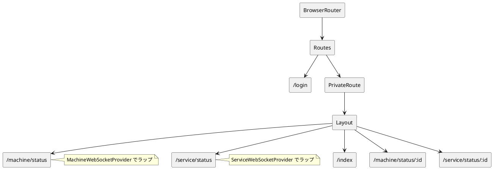
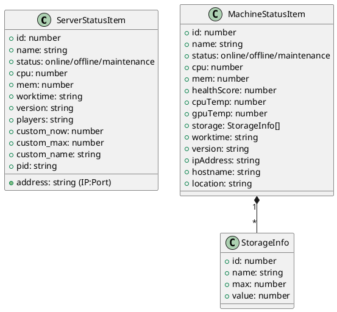

# Pages 目次

## 概要

新規画面の設計案として[エージェント登録管理画面](./3006_agent_registration.md)を追加します。実装済み一覧とは区別します。

`src/pages` 配下の主要ページコンポーネント一覧

---

## ファイル構成

```text
src/pages/
├── Top/
│   ├── LoginPage.tsx      # ログインページ
│   └── TopPage.tsx        # ダッシュボード (トップページ)
└── Servers/
    ├── ServiceStatus/
    │   ├── pages.tsx      # サービスステータスページ
    │   └── service.tsx    # サービスステータスデータ・フック・WebSocket
    └── MachineStatus/
        ├── pages.tsx      # マシンステータスページ
        └── service.tsx    # マシンステータスデータ・フック・WebSocket
```

---

## ページ詳細

| パス | ファイル | 概要 | 行数 |
|------|----------|------|------|
| `/login` | `src/pages/Top/LoginPage.tsx` | 認証ページ (メール/パスワード、JWT) | 163 |
| `/index` | `src/pages/Top/TopPage.tsx` | ダッシュボード (通知一覧、サーバー状況サマリー) | 172 |
| `/service/status` / `/service/status/:serverId` | `src/pages/Servers/ServiceStatus/pages.tsx` | サービス監視 (CPU/メモリ、ジョブ履歴、バックアップ履歴) | 330 |
| - | `src/pages/Servers/ServiceStatus/service.tsx` | サービスデータ定義、WebSocket、リアルタイムマージフック | 189 |
| `/machine/status` / `/machine/status/:serverId` | `src/pages/Servers/MachineStatus/pages.tsx` | マシン監視 (ヘルススコア、温度、ストレージ、ジョブ/バックアップ履歴) | 351 |
| - | `src/pages/Servers/MachineStatus/service.tsx` | マシンデータ定義、WebSocket、リアルタイムマージフック | 265 |

---

## 共通設計パターン

### 1. ページコンポーネント (`pages.tsx`)

- **State管理**: `useState`, `useMemo`, `useParams`
- **データ取得**: `/api/status/services` / `/api/status/machines`
- **リアルタイム**: `useLiveEvent()` (WebSocket ON/OFF)
- **UI**: Card, Select, UsageBar, CustomUsageBar, DetailRow, Table

### 2. サービス層 (`service.tsx`)

- **型定義**: `ServerStatusItem` / `MachineStatusItem`
- **初期データ**: HTTP APIの全件スナップショット
- **セレクタ用**: 取得済みスナップショットから選択肢を生成
- **WebSocket**: `WebSocketProvider`, `useWebSocketService()`
- **データマージ**: `useMergedServerStatus()` / `useMergedMachineStatus()`
- **接続制御**: `useLiveEvent()`

### 3. 共通UIコンポーネント使用

| コンポーネント | インポート元 | 用途 |
|----------------|--------------|------|
| `Card` | `@/components/ui/card` | コンテナ |
| `Select` | `@/components/ui/select` | ドロップダウン選択 |
| `UsageBar` | ページ内定義 | パーセントバー (0-100%) |
| `CustomUsageBar` | ページ内定義 | 現在値/最大値バー |
| `DetailRow` | ページ内定義 | キー/バリュー行 |
| `Button` | `@/components/ui/button` | ボタン |
| `Input` | `@/components/ui/input` | 入力フィールド |
| `SendButton` | `@/components/ui/send-button` | モーダル起動ボタン |
| `ListPagination` | `@/components/ui/list-pagination` | 20・50・100件の表示件数選択と前後移動 |

一覧ページングの適用範囲と状態管理は[一覧ページング共通設計](./0001_list_pagination.md)を参照する。

---

## ルーティング構成 (`src/App.tsx`)



| パス | ページ | 認証 | WebSocket Provider |
|------|--------|------|-------------------|
| `/login` | LoginPage | 不要 | - |
| `/index` | TopPage | 必須 | - |
| `/machine/status` / `/machine/status/:serverId` | MachineStatus | 必須 | `MachineWebSocketProvider` |
| `/service/status` / `/service/status/:serverId` | ServiceStatus | 必須 | `ServiceWebSocketProvider` |

---

## データモデル比較



| 項目 | ServiceStatus | MachineStatus |
|------|---------------|---------------|
| 対象 | ゲームサービス等 | 物理/仮想マシン |
| リソース | CPU, Memory, Custom | CPU, Memory, **Storage, 温度** |
| ヘルススコア | 固定値 (50) | 動的 (`healthScore`) |
| 温度 | なし | CPU/GPU温度 |
| ストレージ | なし | 複数デバイス対応 |
| 識別子 | `address` (IP:Port) | `ipAddress`, `hostname`, `location` |
| 詳細項目 | Players, PID | Hostname |

---

## WebSocket メッセージ形式

### チャネル別の全件スナップショット

```plantuml
@startuml
skinparam componentStyle rectangle
package "Machine Update" {
  [machine_update\n{ type, machines: [], generated_at }] as MU
}
package "Service Update" {
  [service_update\n{ type, services: [], generated_at }] as SU
}
@enduml
```

| タイプ | ServiceStatus | MachineStatus |
|--------|---------------|---------------|
| 全件更新 | `service_update` | `machine_update` |
| 差分更新 | 使用しない | 使用しない |
| エンドポイント | `/ws/services` | `/ws/machines` |

---

## 今後の統一・拡張ポイント

| 領域 | 現状 | 改善案 |
|------|------|--------|
| WebSocketエンドポイント | 用途別 (`/ws/services`, `/ws/machines`) | 実装済み |
| メッセージタイプ | `service_update`, `machine_update` | 実装済み |
| データマージフック | HTTP初期値とWebSocket全件更新を統合 | 実装済み |
| 温度監視 | MachineStatusのみ | 必要に応じてServiceStatusにも |
| ストレージ監視 | MachineStatusのみ | - |
| ヘルススコア | Agent未送信のため未取得表示 | Agentメトリクス収集後に実測値へ変更 |

## 今回追加分

| パス | ファイル | 概要 | 設計書 |
| --- | --- | --- | --- |
| `/master/batch/difinition` / `/master/batch/difinition/:batchDefinitionId` | `src/pages/Master/Batch/Difinition` | バッチ定義マスタの一覧・詳細・登録更新 | [バッチ定義画面](./3001_batch_definition.md) |
| `/master/batch/schedule` / `/master/batch/schedule/:batchScheduleId` | `src/pages/Master/Batch/Schedule` | バッチスケジュールマスタの一覧・詳細・登録更新 | [バッチスケジュール画面](./3002_batch_schedule.md) |
| `/master/items` / `/master/items/:itemId` | `src/pages/Master/Items` | 在庫品目マスタの一覧・詳細・登録更新 | [在庫品目マスタ画面](./3003_item_master.md) |
| `/stock` / `/stock/:itemId` | `src/pages/Stock` | 実在庫の一覧・詳細・登録更新 | [在庫管理画面](./3004_stock.md) |
| `/logs/api` | `src/pages/Logs/View` | ADMIN・OPERATOR向けAPIアクセスログ検索・詳細 | [APIログ画面](./3007_api_access_logs.md) |
| `/settings` | `src/pages/Settings` | 本人のユーザー名・パスワード・テーマ変更 | [個人設定画面](./3010_personal_settings.md) |
| `/vehicles` / `/vehicles/new` / `/vehicles/:vehicleId` | `src/pages/Vehicles` | 車検期限を中心とした車両閲覧・手動登録・編集・管理終了 | [車両管理画面](./3008_vehicle_management.md) |

## 権限制御

- `/master/api`: [外部APIキー管理画面](./3009_external_api_keys.md)。ADMIN限定の発行・一覧・無効化。

管理画面、サイドバー、操作部品の表示制御は [フロントエンド権限制御設計](./3005_frontend_authorization.md) を参照する。
