# Login Page 画面設計書

## 概要

管理画面へのログイン認証を行うページ。メールアドレス/パスワード認証、JWTトークン管理、リダイレクト制御を実装。

---

## 画面構成

### レイアウト構造

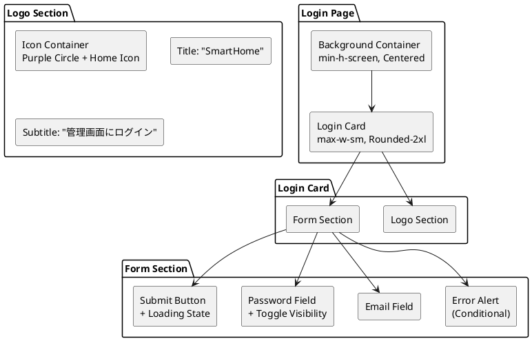

---

## コンポーネント詳細

### 1. 背景・レイアウト

| 要素 | 仕様 |
|------|------|
| 背景色 | `bg-zinc-50 dark:bg-zinc-950` |
| 配置 | Flexbox 中央揃え (`items-center justify-center`) |
| パディング | `px-4` (モバイル対応) |
| 最小高さ | `min-h-screen` |

### 2. ログインカード

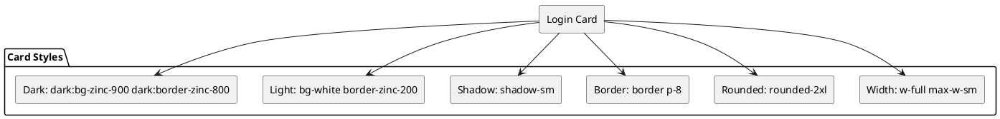

| スタイル | ライトモード | ダークモード |
|----------|-------------|-------------|
| 背景 | `bg-white` | `dark:bg-zinc-900` |
| 枠線 | `border-zinc-200` | `dark:border-zinc-800` |
| 角丸 | `rounded-2xl` | 共通 |
| 影 | `shadow-sm` | 共通 |
| パディング | `p-8` | 共通 |
| 最大幅 | `max-w-sm` (384px) | 共通 |

### 3. ロゴセクション

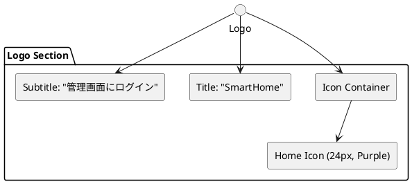

| 要素 | 仕様 |
|------|------|
| アイコン容器 | `rounded-xl bg-purple-500/15 p-3` |
| アイコン | `Home` (lucide-react), 24px, `text-purple-500` |
| タイトル | `text-lg font-semibold text-zinc-900 dark:text-white` |
| サブタイトル | `text-sm text-zinc-500`, "管理画面にログイン" |
| 間隔 | `mb-8`, `gap-3` |

### 4. フォームセクション

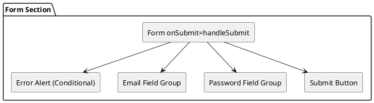

#### 4.1 エラーアラート (条件付き表示)

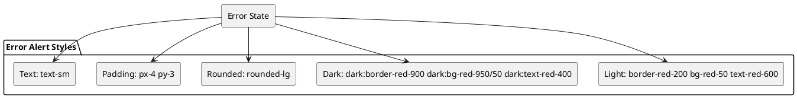

| 状態 | スタイル |
|------|----------|
| 表示条件 | `error &&` (error state が存在する場合) |
| ライト | `border-red-200 bg-red-50 text-red-600` |
| ダーク | `dark:border-red-900 dark:bg-red-950/50 dark:text-red-400` |
| 共通 | `rounded-lg px-4 py-3 text-sm` |

#### 4.2 メールアドレスフィールド

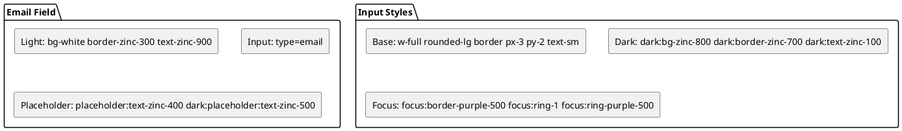

| 属性 | 値 |
|------|-----|
| `id` | "email" |
| `type` | "email" |
| `autoComplete` | "email" |
| `required` | true |
| `placeholder` | "<admin@example.com>" |
| ラベル | "メールアドレス" |

#### 4.3 パスワードフィールド (表示切替付き)

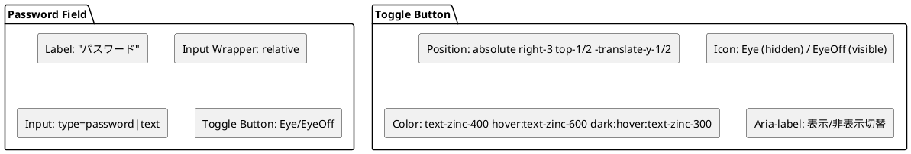

| 要素 | 仕様 |
|------|------|
| `id` | "password" |
| `type` | `showPass ? 'text' : 'password'` |
| `autoComplete` | "current-password" |
| `required` | true |
| `placeholder` | "••••••••" |
| ラベル | "パスワード" |
| 表示切替ボタン | 右端配置、Eye/EyeOff アイコン切替 |

#### 4.4 送信ボタン

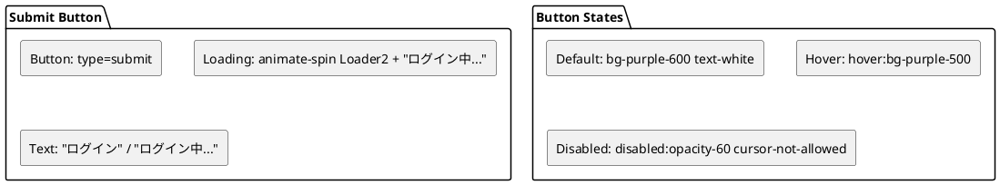

| 状態 | スタイル |
|------|----------|
| デフォルト | `bg-purple-600 text-white` |
| ホバー | `hover:bg-purple-500` |
| 無効 | `disabled:opacity-60 disabled:cursor-not-allowed` |
| ローディング | `Loader2` (animate-spin) + "ログイン中..." |
| 通常時 | "ログイン" |
| 幅 | `w-full` |
| 高さ | `py-2.5` |
| 角丸 | `rounded-lg` |

---

## 状態管理

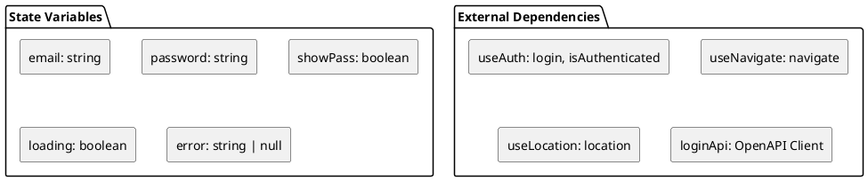

| State | 型 | 初期値 | 用途 |
|-------|-----|--------|------|
| `email` | string | `''` | メールアドレス入力値 |
| `password` | string | `''` | パスワード入力値 |
| `showPass` | boolean | `false` | パスワード表示/非表示 |
| `loading` | boolean | `false` | 送信中フラグ (ボタン制御) |
| `error` | string \| null | `null` | エラーメッセージ表示 |

---

## 認証フロー

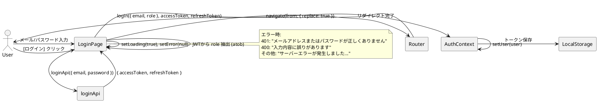

### エラーハンドリング

| HTTP Status | エラーメッセージ |
|-------------|------------------|
| 401 | "メールアドレスまたはパスワードが正しくありません" |
| 400 | "入力内容に誤りがあります" |
| その他 | "サーバーエラーが発生しました。しばらくしてから再試行してください" |

### リダイレクト制御

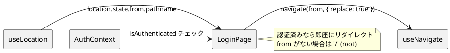

| 条件 | 挙動 |
|------|------|
| `isAuthenticated === true` | `<Navigate to={from} replace />` 即座にリダイレクト |
| `from` 未指定 | `'/'` (ルート) にリダイレクト |
| ログイン成功 | `navigate(from, { replace: true })` |

---

## API 連携

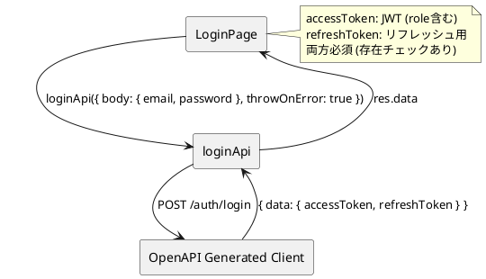

### リクエスト

```typescript
await loginApi({
  body: { email, password },
  throwOnError: true,  // エラー時に例外スロー
})
```

### レスポンス

```typescript
{
  data: {
    accessToken: string,   // JWT (role含む)
    refreshToken: string   // リフレッシュトークン
  }
}
```

### JWT ペイロード解析

```typescript
const payload = JSON.parse(atob(accessToken.split('.')[1]))
role = payload.role ?? 'USER_ROLE'
```

---

## アクセシビリティ

| 要素 | 対応 |
|------|------|
| ラベル | `<label htmlFor="email/password">` 明示的関連付け |
| 必須項目 | `required` 属性 |
| オートコンプリート | `autoComplete="email" / "current-password"` |
| パスワード表示切替 | `aria-label` で "パスワードを表示/隠す" |
| フォーカス表示 | `focus:border-purple-500 focus:ring-1 focus:ring-purple-500` |
| エラー表示 | インラインアラート (色のみでなくテキストで通知) |
| ローディング | ボタン無効化 + スピナー + テキスト変更 |

---

## レスポンシブ対応

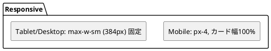

| ブレークポイント | カード幅 | パディング |
|------------------|----------|------------|
| Mobile (< 640px) | `w-full` (px-4 で余白確保) | `px-4` |
| ≥ sm | `max-w-sm` (384px) 中央配置 | `px-4` |

---

## 実装ファイル

```text
src/pages/Top/
└── LoginPage.tsx  # 163行
```

### インポート依存

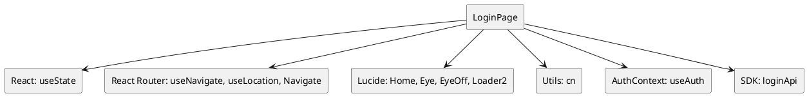

| インポート | 用途 |
|------------|------|
| `useState` | フォーム状態管理 |
| `useNavigate, useLocation, Navigate` | ルーティング制御 |
| `Home, Eye, EyeOff, Loader2` | アイコン |
| `cn` | クラス名結合ユーティリティ |
| `useAuth` | 認証コンテキスト (login, isAuthenticated) |
| `loginApi` | OpenAPI生成ログインAPI |

---

## セキュリティ考慮事項

| 対策 | 実装 |
|------|------|
| パスワード非表示 | `type="password"` デフォルト |
| 入力値サニタイズ | `throwOnError: true` でAPI側バリデーション |
| トークン保存 | `localStorage` (AuthContext内で管理) |
| JWT検証 | ペイロードから role 抽出 (クライアント側) |
| CSRF対策 | SameSite Cookie / トークンベース認証で緩和 |
| ブルートフォース | サーバー側でレート制限推奨 |

---

## 今後の拡張ポイント

1. **ソーシャルログイン**: Google, GitHub, Microsoft 等のOAuth追加
2. **多要素認証 (MFA)**: TOTP, SMS, Email 認証コード
3. **パスワードレス**: Magic Link, WebAuthn (Passkeys)
4. **リメンバー機能**: "ログイン状態を保持" チェックボックス
5. **パスワード強度表示**: 入力時のリアルタイム強度インジケータ
6. **多言語対応**: i18n ライブラリ導入
7. **アカウントロックアウト**: 失敗回数超過時の一時ロック表示
