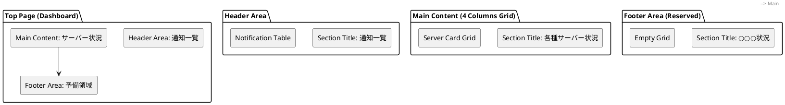
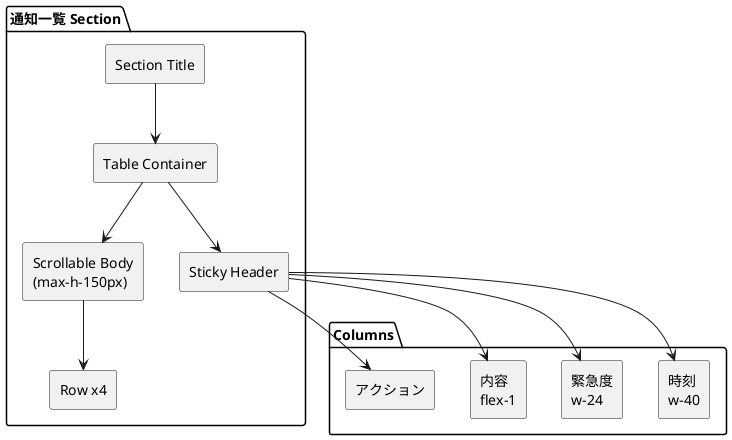
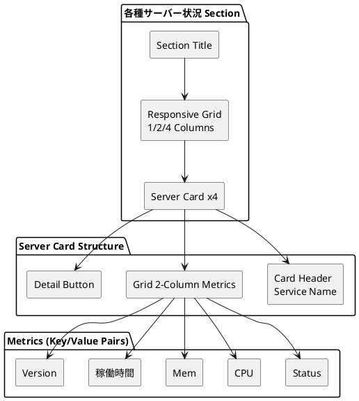
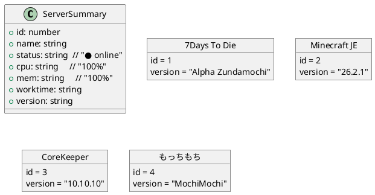
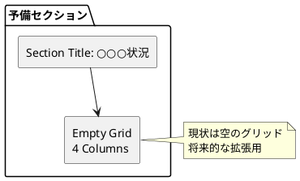
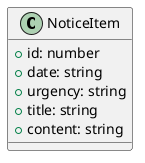
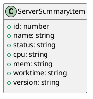
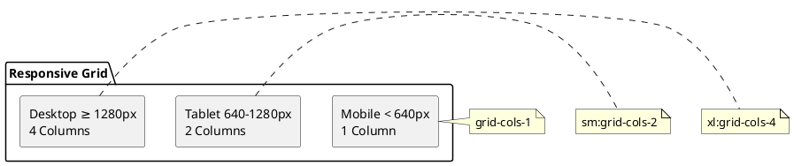

# Top Page (ダッシュボード) 画面設計書

## 概要

システム全体の概要を一目で把握できるダッシュボード画面。通知一覧とサーバー状況のサマリーを表示。

---

## 画面構成

### レイアウト構造



---

## コンポーネント詳細

### 1. 通知一覧セクション



| 要素 | 仕様 |
|------|------|
| セクションタイトル | "通知一覧" (text-xl, font-semibold) |
| テーブル形式 | 固定ヘッダー + 縦スクロール (max-h-150px) |
| カラム | 時刻 / 緊急度 / 内容 / アクション |
| 行ホバー | 背景色変化 (zinc-100/dark:zinc-800) |
| アクション | SendButton "詳細" → InfoModal 表示 |

#### 通知データ (noticeList)

| フィールド | 型 | 例 |
|------------|-----|-----|
| id | number | 1 |
| date | string | "yyyy/mm/dd hh:mm:ss" |
| urgency | string | "緊急" |
| title | string | "タイトルなのだ." |
| content | string | "お兄ちゃんﾌﾞﾁｨ!!" |

#### モーダル連携

```plantuml
@startuml
[SendButton "詳細"] --> [openModal(INFO_MODAL_ID)]
[openModal] --> [InfoModal]
InfoModal : title = data.title + ' (' + data.urgency + ')'
InfoModal : message = data.content
InfoModal : size = 'xl'
@enduml
```

---

### 2. 各種サーバー状況セクション



| 要素 | 仕様 |
|------|------|
| セクションタイトル | "各種サーバー状況" |
| レイアウト | レスポンシブグリッド (1col <sm, 2col sm-xl, 4col ≥xl) |
| カード | Card コンポーネント (p-3, border) |

#### サーバーカード構成

| 領域 | 内容 |
|------|------|
| ヘッダー | サービス名 (h3, border-b) |
| メトリクス (2カラムグリッド) | Status / CPU / Mem / 稼働時間 / Version |
| フッター | "詳細" ボタン → `/status/{id}` 遷移 |

#### メトリクス詳細

| ラベル | 値 | 備考 |
|--------|-----|------|
| Status | `server.status` | "● online" 形式 |
| CPU | `server.cpu` | "100%" 形式 |
| Mem | `server.mem` | "100%" 形式 |
| 稼働時間 | `server.worktime` | "dd day hh:mm" |
| Version | `server.version` | "Alpha Zundamochi" 等 |

#### サーバーデータ (servers)



---

### 3. 予備セクション (○○○状況)



| 要素 | 状態 |
|------|------|
| セクションタイトル | "○○○状況" (プレースホルダー) |
| グリッド | 空 (children なし) |
| 用途 | 将来的な機能追加用予約領域 |

---

## データモデル

### NoticeItem



### ServerSummaryItem



---

## 使用コンポーネント

| コンポーネント | 用途 | インポート元 |
|----------------|------|--------------|
| `Card` | サーバーカード, 通知テーブル容器 | `@/components/ui/card` |
| `Button` | 詳細ボタン | `@/components/ui/button` |
| `SendButton` | 通知詳細ボタン | `@/components/ui/send-button` |
| `useModalManager` | モーダル表示制御 | `@/contexts/ModalContext` |
| `INFO_MODAL_ID` | InfoModal 識別子 | `@/components/modals` |

---

## レスポンシブ対応



| ブレークポイント | サーバーカードグリッド | 予備グリッド |
|------------------|------------------------|--------------|
| `< sm` (640px) | 1カラム | 1カラム |
| `sm` - `xl` | 2カラム | 2カラム |
| `≥ xl` (1280px) | 4カラム | 4カラム |

---

## 実装ファイル

```text
src/pages/Top/
└── TopPage.tsx  # 172行
```

### 主要定数

```plantuml
@startuml
package "TopPage Constants" {
  [servers: ServerSummaryItem[4]] as S
  [noticeList: NoticeItem[4]] as N
}
@enduml
```

| 定数 | 型 | 件数 | 用途 |
|------|-----|------|------|
| `servers` | `ServerSummaryItem[]` | 4 | サーバー状況カード |
| `noticeList` | `NoticeItem[]` | 4 | 通知一覧テーブル |

---

## 今後の拡張ポイント

1. **実データ連携**: 定数データ → API/WebSocket から取得
2. **予備セクション活用**: "○○○状況" を具体的な機能 (アラート、リソース、ネットワーク等) に展開
3. **通知フィルタリング**: 緊急度別フィルタ、既読/未読管理
4. **サーバー検索/ソート**: 名前順、ステータス順、負荷順
5. **リアルタイム更新**: WebSocket で通知・サーバー状況を自動更新
