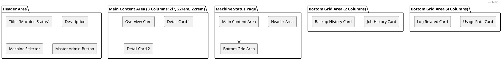
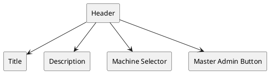
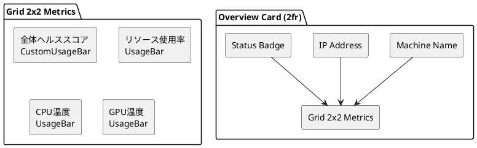
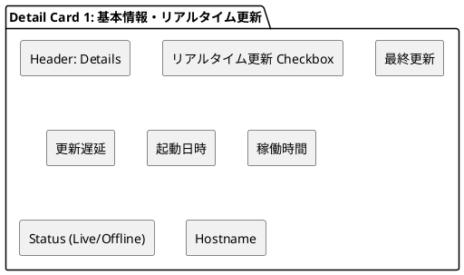
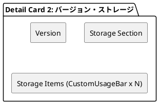
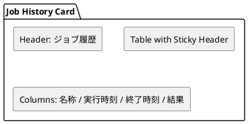
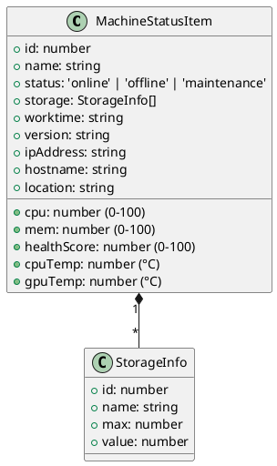
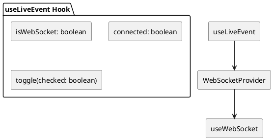
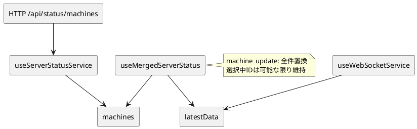
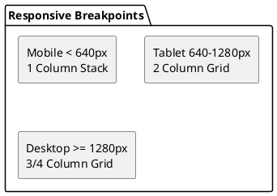

# Machine Status 画面設計書

## 概要

物理/仮想マシン（ホスト）の稼働状況とリソース使用率を監視・管理する画面。WebSocketによるリアルタイム更新に対応。

---

## 画面構成

### レイアウト構造



---

## コンポーネント詳細

### 1. ヘッダー領域

| 要素 | 内容 | 備考 |
|------|------|------|
| タイトル | "Server Status" | 実装では "Server Status" と表示（"Machine Status" への修正推奨） |
| 説明文 | "サーバーの稼働状況とリソース使用率を確認できます。" | |
| マシン選択 | Select コンポーネント | URLパラメータ連動、WebSocket接続時は disabled |
| 設定ボタン | "/master/service" へ遷移 | Button variant="default" |



**State連動:**

- `serverId` パラメータがある場合、選択肢は disabled
- WebSocket接続中（`connected=true`）は選択肢 disabled

### 2. メインコンテンツ（3カラムグリッド: xl画面以上）

#### 2.1 マシン概要カード（左: 2fr幅）



| セクション | コンポーネント | データソース |
|------------|----------------|--------------|
| マシン名 | h2 | `selectedServer.name` |
| アドレス | p | `selectedServer.address` |
| ステータスバッジ | span | `statusLabel[selectedServer.status]` |
| 全体ヘルススコア | CustomUsageBar | `healthScore` (0-100) |
| リソース使用率 | UsageBar | `(cpu + mem) / 2` |
| CPU温度 | UsageBar | `cpuTemp` (°C) |
| GPU温度 | UsageBar | `gpuTemp` (°C) |

#### 2.2 詳細カード1（中: 22rem固定）



| 項目 | コンポーネント | 備考 |
|------|----------------|------|
| リアルタイム更新 | Input type="checkbox" | ONでWebSocket接続開始 |
| 最終更新 | DetailRow | 実測状態の収集日時。未収集時はAgentの最終Heartbeat |
| 稼働時間 | DetailRow | Agentが取得したOS稼働秒数を日・時・分で表示 |
| Status | DetailRow (特殊) | Online/Offline/Maintenance/Unknownと接続状態の色付きドット |
| Hostname | DetailRow | `selectedServer.hostname` |

**WebSocket連動:**

- 接続中: 緑色のドット + 実際のステータスラベル
- 切断中: 赤色のドット + 実際のステータスラベル
- 非接続時: ステータスラベルのみ

#### 2.3 詳細カード2（右: 22rem固定）



| 項目 | コンポーネント | 備考 |
|------|----------------|------|
| Version | DetailRow | `selectedServer.version` |
| Storage | CustomUsageBar × N | `selectedServer.storage.map()` で動的表示 |

### 3. 下部グリッド（2カラム: xl画面以上）

#### 3.1 ジョブ履歴カード



| 仕様 | 詳細 |
|------|------|
| 形式 | 固定ヘッダー + スクロール可能ボディ (max-h-180px) |
| カラム | 名称 / 実行時刻 / 終了時刻 / 結果 |
| 行ホバー | 背景色変化 |

#### 3.2 バックアップ履歴カード

| 仕様 | 詳細 |
|------|------|
| ヘッダー | "最終バックアップ: yyyy/mm/dd hh:mm:ss" |
| 形式 | 固定ヘッダー + スクロール可能ボディ (max-h-150px) |
| カラム | 名称 / 実行時刻 / 終了時刻 / 結果 |

### 4. 下部グリッド（4カラム: xl画面以上）

#### 4.1 使用率カード

| メトリクス | タイプ | 値 |
|------------|--------|-----|
| CPU | UsageBar | `selectedServer.cpu`% |
| Memory | UsageBar | `selectedServer.mem`% |
| Disk IO | UsageBar | 30% (固定) |
| Network IO | UsageBar | `selectedServer.mem`% |

#### 4.2 ログ関連カード

| 項目 | タイプ | 値 |
|------|--------|-----|
| エラー率 | UsageBar | 5% (固定) |
| INFO件数 | DetailRow | "0000 件" |
| ERROR件数 | DetailRow | "0000 件" |
| WARN件数 | DetailRow | "0000 件" |

---

## データモデル

### MachineStatusItem



### SelectOption (Machine Selector)

```typescript
interface SelectOption {
  value: string;   // String(machine.id)
  label: string;   // machine.name
}
```

---

## WebSocket 連携

### 接続管理 (`useLiveEvent`)



### メッセージ形式

```plantuml
@startuml
skinparam componentStyle rectangle
package "WebSocket Message" {
  [Full Update\n{ type: 'machine_update',\n  machines: MachineStatusItem[],\n  generated_at }] as FU
}
@enduml
```

### データマージ (`useMergedServerStatus`)



### UI反映ルール

| 状態 | Status表示 | Machine選択 |
|------|------------|-------------|
| 未接続 | 静的ステータス | 操作可 |
| 接続中 | 🟢 Live | 操作不可 |
| 接続失敗/切断 | 🔴 + 静的ステータス | 操作可 |

---

## レスポンシブ対応



| ブレークポイント | 上部メイン | 下部グリッド |
|------------------|------------|--------------|
| `< sm` (640px) | 1カラムスタック | 1カラムスタック |
| `sm` - `xl` | 2カラム | 2カラム |
| `≥ xl` (1280px) | 3カラム (2fr, 22rem, 22rem) | 4カラム |

---

## 実装ファイル構成

```text
src/pages/Servers/MachineStatus/
├── pages.tsx    # ページコンポーネント
├── service.tsx  # HTTPデータ・フック・WebSocket
```

### 主要フック

| フック | 機能 |
|--------|------|
| `useServerStatusService()` | HTTP APIからマシン状態を取得 |
| `useLiveEvent()` | WebSocket接続制御・状態管理 |
| `useMergedServerStatus()` | HTTP初期値とWebSocket全件更新を統合 |
| `useWebSocket()` | 汎用WebSocketフック |

### 使用コンポーネント

| コンポーネント | 用途 |
|----------------|------|
| `Card` | コンテナ |
| `Select` | マシン選択 (shadcn風カスタム) |
| `UsageBar` | パーセントバー (0-100%) |
| `CustomUsageBar` | 現在値/最大値バー (Storage等) |
| `DetailRow` | キー/バリュー行 (Status行はWebSocket特殊処理) |
| `Input type="checkbox"` | WebSocket ON/OFF |
| `Button` | 設定遷移 |

---

## 今後の拡張ポイント

1. **ジョブ履歴/バックアップ履歴**: 実API連携
2. **Disk IO・Network IO・ログ集計**: Agent収集項目の拡張
3. **macOSメトリクス実機確認**: 取得可能項目と権限の確認
