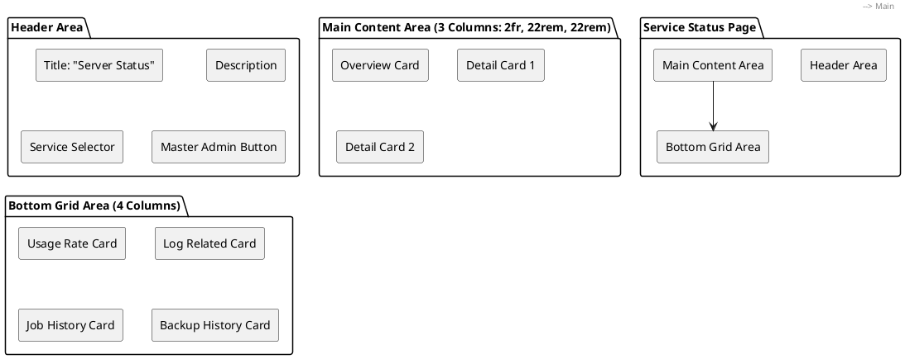
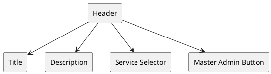
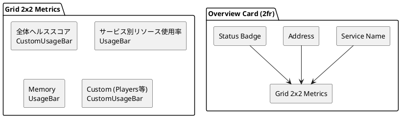
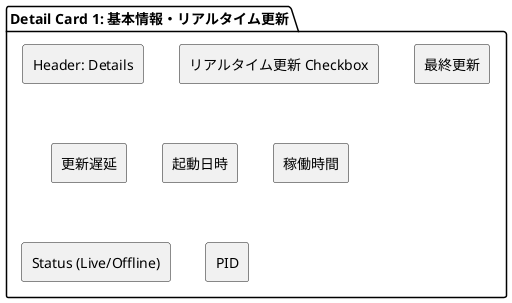
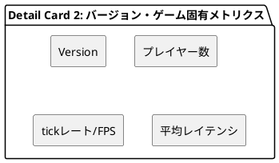
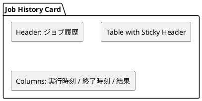
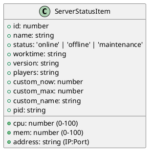

# Service Status 画面設計書

## 概要

ゲームサービス等の稼働状況とリソース使用率を監視・管理する画面。WebSocketによるリアルタイム更新に対応。

---

## 画面構成

### レイアウト構造



---

## コンポーネント詳細

### 1. ヘッダー領域

| 要素 | 内容 | 備考 |
|------|------|------|
| タイトル | "Server Status" | text-xl, font-semibold |
| 説明文 | "サーバーの稼働状況とリソース使用率を確認できます。" | text-sm, text-zinc-500 |
| サービス選択 | Select コンポーネント | URLパラメータ連動、WebSocket接続時は disabled |
| 設定ボタン | "/master/service" へ遷移 | Button variant="default" |



**State連動:**

- `serverId` パラメータがある場合、選択肢は disabled
- WebSocket接続中（`connected=true`）は選択肢 disabled

### 2. メインコンテンツ（3カラムグリッド: xl画面以上）

#### 2.1 サービス概要カード（左: 2fr幅）



| セクション | コンポーネント | データソース |
|------------|----------------|--------------|
| サービス名 | h2 | `selectedServer.name` |
| アドレス | p | `selectedServer.address` (IP:Port) |
| ステータスバッジ | span | `statusLabel[selectedServer.status]` |
| 全体ヘルススコア | CustomUsageBar | 固定値 50/100 |
| サービス別リソース使用率 | UsageBar | `selectedServer.cpu` |
| Memory | UsageBar | `selectedServer.mem` |
| カスタム項目 | CustomUsageBar | `custom_name`, `custom_now`, `custom_max` |

#### 2.2 詳細カード1（中: 22rem固定）



| 項目 | コンポーネント | 備考 |
|------|----------------|------|
| リアルタイム更新 | Input type="checkbox" | ONでWebSocket接続開始 |
| 最終更新 | DetailRow | サービス実測状態の収集日時。未収集時はAgentの最終Heartbeat |
| 稼働時間 | DetailRow | Agentが取得したプロセス稼働秒数を日・時・分で表示 |
| Status | DetailRow (特殊) | Online/Offline/Maintenance/Unknownと接続状態の色付きドット |
| PID | DetailRow | `selectedServer.pid` |

**WebSocket連動:**

- 接続中: 緑色のドット + 実際のステータスラベル
- 切断中: 赤色のドット + 実際のステータスラベル
- 非接続時: ステータスラベルのみ

#### 2.3 詳細カード2（右: 22rem固定）



| 項目 | コンポーネント | 値 |
|------|----------------|-----|
| Version | DetailRow | `selectedServer.version` |
| プレイヤー数 | CustomUsageBar | 10 / 88659 (固定) |
| tickレート/FPS | CustomUsageBar | 10 / 60 (固定) |
| 平均レイテンシ | CustomUsageBar | 10 / 60 (固定) |

### 3. 下部グリッド（4カラム: xl画面以上）

#### 3.1 使用率カード

| メトリクス | タイプ | 値 |
|------------|--------|-----|
| CPU | UsageBar | `selectedServer.cpu`% |
| Memory | UsageBar | `selectedServer.mem`% |
| Disk IO | UsageBar | 30% (固定) |
| Network IO | UsageBar | `selectedServer.mem`% |

#### 3.2 ログ関連カード

| 項目 | タイプ | 値 |
|------|--------|-----|
| エラー率 | UsageBar | 5% (固定) |
| INFO件数 | DetailRow | "0000 件" |
| ERROR件数 | DetailRow | "0000 件" |
| WARN件数 | DetailRow | "0000 件" |

#### 3.3 ジョブ履歴カード



| 仕様 | 詳細 |
|------|------|
| 形式 | 固定ヘッダー + スクロール可能ボディ (max-h-180px) |
| カラム | 実行時刻 / 終了時刻 / 結果 |
| 行ホバー | 背景色変化 |
| データ | プレースホルダー5行 |

#### 3.4 バックアップ履歴カード

| 仕様 | 詳細 |
|------|------|
| ヘッダー | "最終バックアップ: yyyy/mm/dd hh:mm:ss" |
| 形式 | 固定ヘッダー + スクロール可能ボディ (max-h-150px) |
| カラム | 実行時刻 / 終了時刻 / 結果 |
| データ | プレースホルダー5行 |

---

## データモデル

### ServerStatusItem



### SelectOption (Service Selector)

```typescript
interface SelectOption {
  value: string;   // String(server.id)
  label: string;   // server.name
}
```

---

## WebSocket 連携

1. `/api/status/services` から初期スナップショットを取得する。
2. リアルタイム更新を有効にすると、`/api/status/websocket-ticket` から一回限りのチケットを取得する。
3. `/ws/services` へ接続し、`service_update` の `services` 配列で全件を置き換える。
4. リモート切断時は新しいチケットを発行して再接続する。利用者による明示切断時は再接続しない。

詳細な認証・メッセージ契約は
[マシン・サービス状態取得／リアルタイム配信](../05_API_Design/API/0045_status_streaming.md)を参照する。

AgentはWindows Service Control ManagerまたはLinux systemdからサービス状態とPIDを取得し、
対応プロセスのCPU・メモリ・稼働時間を送信する。3分以内かつ現在の登録世代の値だけを表示する。
`metricsAvailable=false` の項目は固定値で補完せず「未取得」と表示する。
プレイヤー数、tickレート/FPS、平均レイテンシはゲーム固有メトリクスであり、今回の収集対象外とする。
