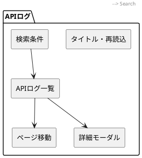
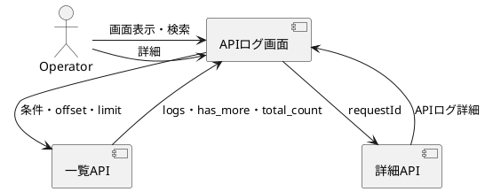

# APIログ画面設計書

## 概要

ADMINおよびOPERATORがAPIアクセス履歴を検索し、エラーや遅延の発生状況を確認する運用画面とする。

## 画面構成

## コンポーネント詳細

### 1. 検索条件

| 要素 | 仕様 |
| --- | --- |
| 初期期間 | 現在から過去24時間 |
| 日時 | 開始・終了を日時入力で指定 |
| メソッド | 定義済みHTTPメソッドから選択 |
| ステータス | 区分またはコードを指定。後から入力した条件を優先表示 |
| 発生元 | Web、Agent、IoT、Gateway、未認証 |
| その他 | パス、操作者、IP、最小処理時間 |

### 2. 一覧

検索日時はブラウザのDateで解釈し、UTCのISO文字列に変換してAPIへ送信する。
空欄の条件はクエリから省略する。パス・操作者・IPの前後空白は送信前に除去する。
API側の正規化・期間上限は[APIアクセスログ取得](../05_API_Design/API/0046_api_access_logs.md)を参照する。

| 項目 | 仕様 |
| --- | --- |
| 表示順 | 発生日時の降順 |
| 件数 | 初期20件。20・50・100件から選択 |
| 4xx | 黄色系背景とステータス表示 |
| 5xx | 赤色系背景とステータス表示 |
| 操作 | 詳細ボタンでモーダルを開く |

## 状態管理

| State | 型 | 初期値 | 用途 |
| --- | --- | --- | --- |
| inputs | 検索条件 | 直近24時間 | 編集中の条件 |
| search | 検索条件 | 直近24時間 | APIへ適用済みの条件 |
| logs | APIログ配列 | 空配列 | 一覧表示 |
| totalCount | number | 0 | 検索結果件数 |
| pageSize | number | 20 | 1ページの表示件数 |
| pageIndex | number | 0 | 0始まりのページ位置 |
| detailRequestId | stringまたはnull | null | 詳細モーダル対象 |

## 操作フロー

## エラーハンドリング

| 条件 | 表示内容 | 挙動 |
| --- | --- | --- |
| 一覧取得失敗 | APIログ一覧の取得に失敗しました。 | ページ上部に通知し、再読込可能 |
| 詳細取得失敗 | APIログ詳細の取得に失敗しました。 | モーダル内に通知し、閉じる操作を維持 |
| USERの直接遷移 | 表示なし | `/index`へ戻す |

## アクセシビリティ

| 要素 | 対応 |
| --- | --- |
| 検索項目 | ラベルと入力を関連付ける |
| 詳細 | dialogロールと閉じる操作を提供 |
| エラー | alertロールでページ上部へ表示 |
| ボタン | アイコンだけにせず操作名を併記 |

## レスポンシブ対応

| ブレークポイント | 表示方針 |
| --- | --- |
| Mobile | 検索条件を1列表示し、一覧は横スクロール |
| Desktop | 検索条件を複数列表示し、一覧を全幅表示 |

## 実装ファイル

| 種別 | パス |
| --- | --- |
| 画面 | `src/pages/Logs/View/page.tsx` |
| 詳細モーダル | `src/pages/Logs/View/ApiAccessLogDetailModal.tsx` |
| APIサービス | `src/pages/Logs/View/service.ts` |
| ルーティング | `src/App.tsx` |

ページングの共通操作は[一覧ページング共通設計](./0001_list_pagination.md)を参照する。

## 今後の拡張ポイント

1. 件数・エラー率・応答時間の集計グラフ
2. 保持期間設定画面
3. CSVエクスポート
