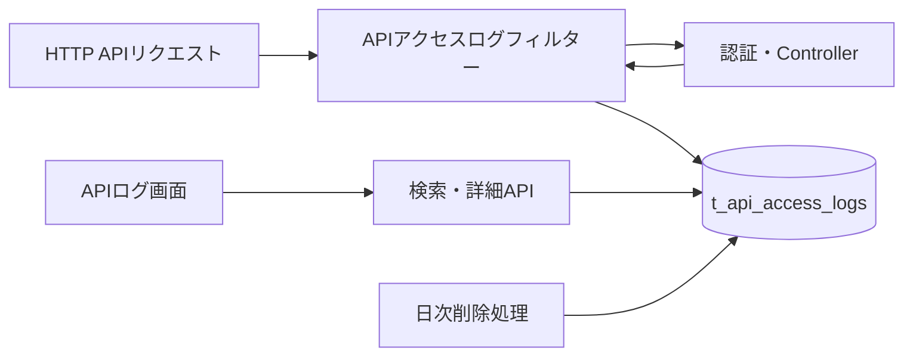

# APIアクセスログ基本設計

## 概要

HTTP APIへのアクセス結果を機密情報を除外してDBへ記録し、運用担当者が画面から検索・確認できるようにする。

## 目的

API障害、遅延、利用経路、認証・認可エラーの発生状況をリクエスト単位で追跡する。

## 対象範囲

| 区分 | 内容 |
| --- | --- |
| 対象 | OPTIONSを除く`/api/**`へのHTTPアクセス |
| 対象外 | WebSocket通信、静的ファイル、Swagger UI、リクエスト・レスポンス本文 |
| 別管理 | バッチ実行ログ、不正アクセス監査イベント、アプリケーションテキストログ |

## 全体構成

## 構成要素

| 構成要素 | 役割 |
| --- | --- |
| APIアクセスログフィルター | リクエストID発行、処理時間計測、応答後のログ登録 |
| APIアクセスログService | 検索条件検証、ページング、保持期間適用 |
| APIアクセスログRepository | 追記、条件検索、詳細取得、期限切れ削除 |
| APIログ画面 | 絞り込み、一覧、エラー強調、詳細表示 |
| 日次削除処理 | デフォルト30日を超えたログの削除 |

## 記録方針

| データ | 方針 |
| --- | --- |
| リクエストID | サーバーでUUIDを発行し、`X-Request-ID`レスポンスヘッダーでも返す |
| リクエストパス | クエリ文字列を除外して保存する |
| 操作主体 | 認証済みユーザーまたはAgentの識別子を保存する |
| IPアドレス | 接続元アドレスを保存し、未検証の転送ヘッダーは信用しない |
| エラーコード | 共通エラー応答で決定したコードだけを保存する |
| 機密情報 | Authorization、Cookie、APIキー、本文を保存しない |

## エラー方針

| 事象 | 対応 |
| --- | --- |
| ログ保存失敗 | 警告ログを出力し、本来のAPIレスポンスは変更しない |
| 不正な検索条件 | HTTP 400 `INVALID_REQUEST`を返す |
| 対象ログなし | HTTP 404 `RESOURCE_NOT_FOUND`を返す |
| USERの閲覧 | HTTP 403 `ACCESS_DENIED`を返す |

## 保持期間

デフォルト保持期間は30日とし、毎日02:15に期限切れログを削除する。
保持日数と実行Cronは環境変数で変更可能とする。

環境変数名、記録無効時の動作、保持日数の下限と削除境界は
[設定管理設計](../07_OperationsDesign/0002_configuration_management.md)を参照する。

## 関連ドキュメント

- [FR-0040 APIログ表示](../01_RequirementsDefinition/FR/0040.md)
- [ログ保持期間](../01_RequirementsDefinition/NFR/0017.md)
- [不正アクセス監査イベント設計](../11_SecurityDesign/0006_security_event_audit.md)
