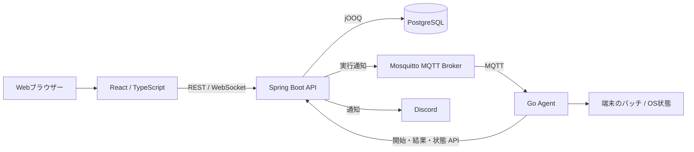

# MomiServer

自宅サーバーと日常の管理業務を、Web画面・API・端末Agentで一元管理する個人開発プロジェクトです。
Java / Spring Boot、React / TypeScript、Goを組み合わせ、在庫管理、車検期限管理、バッチ実行、監視、通知を実装しています。

このリポジトリは、設計・実装・検証の取り組みを技術ポートフォリオとして紹介する公開用スナップショットです。
本番導入前の開発版であり、すべての運用要件が受入確認済みという意味ではありません。

## 開発の目的

- 自宅サーバーの稼働状況、在庫、車検期限など、分散した管理情報を集約する。
- Webアプリケーションだけでなく、端末で動作するAgentと連携するシステムを構築する。
- 要件定義から設計、実装、自動テスト、静的解析、運用設計までを一貫して整理する。
- 通信断、再起動、更新作業など、正常系以外の動作を考慮した設計に取り組む。

## 主な機能

| 機能 | 実装内容 |
| --- | --- |
| 認証・権限制御 | JWT認証、リフレッシュトークン、ADMIN / OPERATOR / USERによる画面・APIの利用制御 |
| ログイン保護 | 失敗回数の管理、一時ロック、DBへのロック状態保存、管理者通知 |
| 在庫管理 | 品目マスタ、在庫一覧・詳細、入庫・出庫・棚卸、操作履歴、在庫注意・在庫切れ通知 |
| 車両管理 | 車両情報、車検期限、期限更新、期限通知、車検証PDF・画像からの入力補助 |
| バッチ管理 | 定義・添付ファイル・Cronスケジュール、日次・週次・月次カレンダー、実行要求・結果・ログ |
| Agent連携 | 登録・認証更新、MQTT命令受信、バッチ実行、結果返却、CPU・メモリ・ストレージ等の状態送信 |
| 状態監視 | マシン・サービスの状態表示とWebSocketによる更新 |
| 通知 | ブラウザー内通知、Discord配信、通知ルート、未読件数、既読・非表示操作 |
| 外部向けAPI | 在庫参照・更新用APIキーの発行・無効化、有効期限、スコープ管理 |
| 管理機能 | ユーザー・端末・サービス等のマスタ、APIログ、共通設定、ユーザー名・パスワード・テーマ設定 |

PDFはテキスト抽出を優先し、画像等にはOCRを利用します。抽出内容は確認・修正してから登録する方式で、すべての帳票を無確認で自動登録するものではありません。

## 技術スタック

バージョンは、このスナップショットのビルド定義に基づく主な指定値です。
最新バージョンであることや、依存関係全体の安全性を保証する一覧ではありません。

| 領域 | 採用技術 |
| --- | --- |
| Backend | Java 25、Spring Boot 3.5.0、Spring Security、Spring Validation |
| DBアクセス | PostgreSQL 17互換、jOOQ 3.20.3、Flyway |
| Backendビルド | Gradle Wrapper 9.4.1、Groovy DSL |
| Frontend | React 19、TypeScript 6、Vite 7、React Router 7 |
| UI | Tailwind CSS 3、Base UI、Lucide React |
| APIクライアント | Axios、OpenAPI生成クライアント、springdoc-openapi |
| Agent | Go 1.25.14以上、Eclipse Paho、gopsutil |
| 通信 | REST API、WebSocket、MQTT、Eclipse Mosquitto |
| 文書取込 | Apache PDFBox、Tesseract OCR |
| 自動テスト | JUnit 5、Mockito、Spring Security Test、Testcontainers、Node.js Test Runner、Playwright、Go標準テスト |
| 品質確認 | JaCoCo、SonarQube、SpotBugs、reviewdog、OWASP Dependency-Check、OWASP ZAP |
| 設計ドキュメント | Markdown、MkDocs Material、PlantUML |

## システム構成



バッチの実行予定と実行要求はBackendで管理し、実際のプロセスはAgent側で起動します。
Agentから受け取った端末・サービス状態はBackendで管理し、WebSocketを通じて画面へ反映します。
MQTTの専用認証・ACLを利用するには、ブローカーとBackendの導入設定が必要です。

## 設計・実装で重視した点

### 認証と認可の境界

Web利用者のJWT、Agentの専用認証、外部連携用APIキーを分け、用途の異なる資格情報を共用しない構成です。
Frontendの表示制御だけでなくBackendでも認可し、通知は閲覧可能な対象に絞り込みます。
トークン用ハッシュの生成・比較は共通部品へ集約し、パスワード用BCryptやファイルのチェックサムとは責務を分けています。

### 通信断とバッチ結果の保護

Agentは実行ID、開始意図、結果をローカルへ永続化し、再起動後に成否不明の処理を自動再実行しません。
確定結果は、Backendが同じ実行ID・結果状態の受理を返すまで保持・再送します。
保持日数・試行回数による自動破棄は行いませんが、通信タイムアウト・再送間隔・プロセス実行期限は別に管理します。

未受理結果がある場合は新規起動を抑制し、既存処理の監視・取消・結果送信は続けます。
これは結果保存領域そのものの故障・喪失まで防ぐ仕組みではありません。

### 更新作業を考慮した保守制御

Backendの保守APIで、新規バッチの開始・自動配信を止め、実行中の完了を待つための状態を確認できます。
保守状態はファイルへ永続化し、Backend再起動後も維持します。
単一Backend向けの実装であり、全業務の書き込み停止や自動デプロイを実現したものではありません。

### 保守性と画面の共通動作

- 業務時刻を注入可能なClockへ集約し、日本時間の扱いと時刻依存テストを統一する。
- DBアクセスはRepositoryへ集約し、jOOQ生成コードとFlywayでスキーマ変更を管理する。
- 状態は用途別Enum、定数はカテゴリ別パッケージ、通知・APIエラー文面はメッセージカタログで管理する。
- Frontendの日時表示、APIエラー取得、非同期取得、ページングを共通化する。
- 一覧は初期20件、20 / 50 / 100件の切替を基本とし、検索時の先頭復帰や取得失敗時の正常行保持を揃える。

## 品質確認

開発元ではGitLab CIでテスト・解析を実行し、SonarQubeの品質ゲート、SpotBugsとreviewdogによるMRレビュー、依存関係検査等を整備しています。
この公開スナップショットにはGitLab CI定義が含まれていないため、GitHubへpushするだけで同じCIが動く構成ではありません。
関連するGradleタスク・テスト・CI補助スクリプトは収録しています。

以下は2026年10月31日の開発時検証記録です。今回のREADME作成で再実行した結果ではありません。

| 対象 | 記録された結果 | 確認範囲 |
| --- | --- | --- |
| Backend | JUnit 780件、失敗・エラー0、スキップ22件。bootJar成功 | 専用PostgreSQLを使用した検証 |
| OCR追加試験 | 33件中32件成功、1件スキップ | Linux JDK 25。実Tesseract環境依存試験は別 |
| SpotBugs | 指摘0件 | ローカルXMLレポート。SonarQubeの品質ゲート通過とは別 |
| Frontend | 単体40件成功、lint・build成功 | Node.js単体試験、ESLint、TypeScript、Vite |
| Frontend回帰 | Playwright 97件成功 | 模擬API。実Backend結合試験とは別 |
| Agent | Goテスト・go vet成功、Linuxでrace試験成功 | Windowsのrace試験成功を意味しない |
| 画面操作 | ユーザー・端末一覧の検索、ページング、再試行等を確認 | アプリ内ブラウザーと実Backend・専用DBを使用 |

詳細は[検証・更新記録](0001-docs-MomiServer_Backend/docs/90_MeetingMinutesAndNotes/weekly_document_progress_20261031.md)を参照してください。
環境依存のスキップ、未確認の運用条件、今後の回帰試験は残っています。

## リポジトリ構成

複数の開発リポジトリを一つにまとめた構成です。フォルダー名は収録時の表記を維持しています。

| ディレクトリ | 内容 |
| --- | --- |
| [0001-src-MomiServer_Backebnd](0001-src-MomiServer_Backebnd/) | Java / Spring Boot Backend。`Backebnd`は実際のフォルダー名 |
| [0001-src-MomiServer_Frontend](0001-src-MomiServer_Frontend/) | React / TypeScript Frontend |
| [0002-src-momiserveragent](0002-src-momiserveragent/) | Go製端末Agent |
| [0001-docs-MomiServer_Backend](0001-docs-MomiServer_Backend/) | 要件定義、基本・詳細設計、API・DB・画面・テスト・運用設計、判断・進捗記録 |
| [0002-doc-momiserveragent](0002-doc-momiserveragent/) | Agent関連設計ドキュメント |
| [mosquitto](mosquitto/) | MQTTブローカー関連ファイル |
| [ツール/SonarQube](ツール/SonarQube/) | SonarQube解析結果の取得ツール |

## ローカルで確認する場合

### 前提

- Java 25、Node.js 24系、Go 1.25.14以上、PostgreSQL 17互換環境を用意する。
- DB接続、JWT署名鍵、必要なAPI接続先等を自分の検証環境に合わせて設定する。
- Agent連携にはMQTTブローカーと登録・認証設定、画像OCRにはTesseractと日本語・英語の言語データを用意する。
- 初回のGradle・npm・Go依存物の取得には、各配布元へ接続できる環境または適切なミラーを用意する。

### Backend

Backendディレクトリで、DB接続用環境変数を設定してから実行します。Windows PowerShellの例です。

```powershell
.\gradlew.bat flywayMigrateOnly generateJooq bootRun
```

Flyway適用とjOOQ生成はDBへの接続を必要とします。共有・運用DBではなく専用の検証DBを使用してください。
接続変数・初期設定の詳細は[Backend README](0001-src-MomiServer_Backebnd/README.md)を参照してください。

### Frontend

Frontendディレクトリで実行します。

```shell
npm ci
npm run dev
```

API接続先は`VITE_API_BASE_URL`で指定でき、未設定時は`http://localhost:8080`を使用します。
BackendのCORS許可元もFrontendのURLと一致させてください。

### Agent

Agentディレクトリでビルドし、管理画面で発行した登録コードを使って登録します。
資格情報の保存先・実行ユーザー・TLS・MQTT設定は[Agent README](0002-src-momiserveragent/README.md)を参照してください。

```shell
go build -trimpath -o dist/momiserver-agent .
```

### テスト

各ディレクトリで実行する代表的なコマンドです。BackendのDB依存試験には専用DBが必要です。

| 対象 | コマンド |
| --- | --- |
| Backend | Windows: `.\gradlew.bat test bootJar`、Linux: `./gradlew test bootJar` |
| Frontend単体・静的確認 | `npm run test:unit`、`npm run lint`、`npm run build` |
| Frontend画面回帰 | Chromium導入後に`npm run test:e2e` |
| Agent | `go test ./...`、`go vet ./...` |

## 開発中・今後の対応

- 実CI・サーバー側品質ゲートの継続確認と、要件ごとのテスト対応整理。
- 長時間停止、更新順序、バックアップ・復元などの本番運用受入確認。
- 緊急管理者の復旧手順、停止中に未判定だった通知の扱いの具体化。
- Gitリポジトリ管理とCI/CD機能のMomiServer本体への内蔵。

Git機能は要件・基本設計とJGit Smart HTTPの隔離技術検証までで、本体の管理画面・Git通信基盤・CI/CDは未実装です。
技術検証用の独立プロジェクトを、そのまま本番Gitサーバーとして提供する想定ではありません。
現在の残課題は[開発タスク一覧](0001-docs-MomiServer_Backend/docs/90_MeetingMinutesAndNotes/project_task_list.md)にまとめています。

## 公開資料としての注意事項

- 個人の技術紹介用です。開発環境固有のホスト名・設定例・過去の進捗記録は、そのまま第三者の環境へ適用しないでください。
- 起動設定の開発用既定値を本番へ流用せず、パスワード・署名鍵・APIキー等は環境変数等で管理してください。
- 公開スナップショットは、現在の脆弱性がすべて解消済みであることや本番運用の安全性を保証するものではありません。
- ソース公開とライセンスによる利用許諾は別です。このスナップショットにはLICENSEファイルを収録していません。再利用・再配布時は利用条件を確認してください。

## 関連ドキュメント

- [システム設計](0001-docs-MomiServer_Backend/docs/02_SystemDesign/000_index.md)
- [Phase 1作成物・確認範囲](0001-docs-MomiServer_Backend/docs/00_ProjectOverview/010_phase1_deliverables.md)
- [Agent常駐・バッチ保守運用](0001-docs-MomiServer_Backend/docs/07_OperationsDesign/0004_agent_batch_runtime.md)
- [本番導入・受入設計](0001-docs-MomiServer_Backend/docs/07_OperationsDesign/0005_production_acceptance.md)
- [JGit Smart HTTP技術検証](0001-docs-MomiServer_Backend/docs/08_TestDesign/0017_jgit_smart_http_spike.md)
